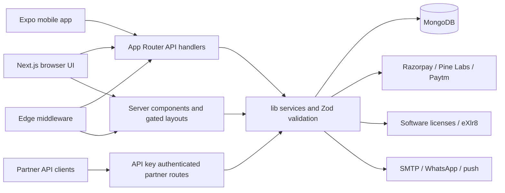
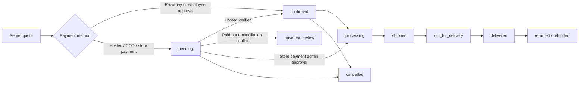

# Application architecture review

Inspected 2026-10-25. This report describes the current source checkout, including the existing uncommitted login-return change. Inspection was read-only for application code. No build, lint, tests, database queries, migrations, provider requests, or application endpoints were executed during this review. Environment variable values and private exports were not read or included.

The source was used to verify behavior; CLAUDE.md and AGENTS.md contain older claims. All API routes were inventoried by path, exported HTTP method, and guard references. The core authentication, checkout, order, inventory, and payment implementations were traced directly. The inventories below are navigation aids, not a line-by-line security audit of every listed file.

## Stack and application boundaries

| Area | Current implementation | Evidence |
| --- | --- | --- |
| Web framework | Next.js 15.5.27, App Router | package.json, package-lock.json, app/ |
| Web UI | React / React DOM 19.2.1 | package.json, package-lock.json |
| Language | TypeScript; strict mode; lock resolves TypeScript 5.9.3 | tsconfig.json, package-lock.json |
| Package manager | npm; root and mobile have separate package-lock.json files | package.json, package-lock.json, mobile/package.json |
| Database | MongoDB, native driver 6.11.0 | lib/mongodb.ts, lib/db-service.ts |
| ORM / ODM | None; no Prisma, Mongoose, Drizzle, or Sequelize dependency | package.json; native MongoDB collections and transactions |
| Authentication | Custom HMAC-SHA256 signed sessions; bcryptjs 2.4.3 password verification; custom Google sign-in | lib/session.ts, lib/auth.ts, lib/auth-credentials.ts, lib/auth-google.ts |
| Payment providers | Razorpay SDK 2.9.5; Pine Labs Plural HTTP integration; Paytm HTTP integration with paytmchecksum 1.5.1 | lib/razorpay.ts, lib/hosted-payment-providers.ts |
| Offline methods | COD, employee-approved in-store purchase, pay-at-store with admin confirmation | lib/payment-config.ts, lib/store-payment.ts |
| Validation | Zod 3.25.67; shared and route-local schemas | lib/validation.ts, types/payment-gateways.ts |
| Testing | Node built-in test runner; Playwright 1.64.1 | tests/, playwright.config.ts, e2e/ |
| Mobile | Separate Expo 54 / Expo Router 6 app; React Native 0.81.5, React 19.1.0 | mobile/package.json |

NextAuth is not declared in the current package.json. lib/auth.ts retains an unused authOptions placeholder. A NEXTAUTH_SECRET fallback and NEXTAUTH_URL configuration names remain; these do not indicate a NextAuth runtime.

The web application is a single full-stack Next.js deployment. app/ owns pages, layouts, and route handlers. components/, hooks/, and contexts/ implement interactive UI; lib/ owns database access, pricing, credentials, payments, fulfillment, notifications, consent, and retention. types/ contains shared contracts. mobile/ is a separate client consuming the same backend, not a second order service.

app/layout.tsx is a server component; app/providers.tsx provides AuthProvider, CartProvider, CartUIProvider, theme, motion and notifications. AuthContext hydrates through /api/auth/session. CartContext and cart hooks combine guest localStorage with authenticated MongoDB cart synchronization. Storefront data uses SWR and browser cache helpers. Admin/account/dashboard requests commonly use lib/api-client.ts.

Route handlers default to Node.js. middleware.ts verifies the session using Edge-safe Web Crypto; app/og/route.tsx explicitly uses Edge. next.config.mjs externalizes server database/native packages and keeps them out of browser bundles. Dynamic route parameters use Next 15 Promise-based params.

No actual `use server` directive was found in application TypeScript/TSX. Mutations are implemented as HTTP API route handlers, not Server Actions. Server components reading data and Next.js after() background work are separate mechanisms.

## Authentication and authorization

- Web password login: app/login/page.tsx -> contexts/AuthContext.tsx -> POST /api/auth/login -> verifyCredentials() -> bcrypt comparison against users -> signed session cookie. Cookies are httpOnly, secure in production, SameSite=lax, with optional COOKIE_DOMAIN and a 24-hour lifetime.
- Session tokens are base64url payload plus HMAC signature, with a random ID per issued token. getSession() accepts either the cookie or Authorization: Bearer, verifies the token, checks its SHA-256 digest against revoked_sessions, loads the current user record, checks account status and sessionVersion, then uses the live user role/permissions. It is not merely decoding a client role.
- Logout expires browser cookies and revokes the presented token until its signed expiry. Native logout also revokes its presented access token; logout everywhere increments the live user's sessionVersion and revokes refresh sessions. The mobile logout caller sends its existing bearer token without refreshing the token pair first. See [the authentication test report](../security/authentication-test-report.md) for verified cases and storage-failure behavior.
- Browser AuthContext adds a 24-hour session timeout and 12-hour inactivity timeout. localStorage identity hints are presentation/hydration aids. The /api/auth/session route returns 200 with user:null for logged-out users and 503 for service failure.
- Registration: app/register/page.tsx -> POST /api/auth/signup. The route validates input, applies bot/rate controls, rejects duplicate emails, hashes the password with bcrypt cost 12, creates a role=user record, records consent, and emails a 24-hour verification link. Successful signup does not silently establish a logged-in session. Google onboarding has its own completion route.
- Google authentication is implemented in lib/auth-google.ts and the web/native Google routes, with token verification and explicit onboarding completion for new accounts.
- Native authentication: /api/v1/auth/* uses one-hour signed access tokens and 60-day opaque refresh tokens. refresh_tokens stores hashes; rotation and reuse detection revoke the token family. mobile/src/auth/token-store.ts uses native secure storage.
- requireUser(), requireAdmin(), requireFullAdmin(), requireVendor(), staffCanAccessApi(), and order-admin scope logic are the core guards. Roles include user, vendor, admin, superadmin, with dashboardAccess and allowedPages for staff.
- app/admin/layout.tsx is an authoritative dynamic server gate. Account, dashboard, and vendor layouts follow the server-session pattern. Client shells handle presentation and navigation.
- middleware.ts matches API and privileged-page prefixes, performs token and path/method role checks, and forwards x-sara-request-path. It permits the ordinary admin HTML/RSC requests to reach the server layout to avoid navigation races. Handlers must still enforce their own authorization. /api/v1/partner/* has independent API-key auth/CORS; /api/v1/auth/* authenticates in its own handlers.
- Login returns prioritize a validated redirect query, then the current tab's last non-auth page, then a stored intent/referrer. lib/return-path.ts rejects off-site and auth-page targets and checks admin/vendor destinations against role.

## Database model and schemas

lib/mongodb.ts validates MONGODB_URI at module load, caches a MongoClient connection promise, and selects MONGODB_DB, then DB_NAME, then e-commerce-bytewise. lib/db-service.ts provides collection access, CRUD helpers and ID normalization. lib/db.ts is a deprecated shim. normalizeId() converts MongoDB _id into a string id.

Schemas are application-level Zod schemas and TypeScript interfaces rather than ORM models. Relevant locations:

| Location | Contracts |
| --- | --- |
| lib/validation.ts | Login, registration, password recovery, product, address, order-update, partner, license, employee and external-webhook validation |
| lib/auth-credentials.ts | Persisted auth-user record and safe authenticated-user view |
| lib/product-schema.ts | Canonical catalogue columns and merchandising taxonomy: division -> category/group -> segment |
| lib/product-specification-schema.ts | Product specification import/normalization |
| lib/order-document.ts | Native MongoDB order document, status history, store-payment proof and fulfillment fields |
| types/order.ts | Older narrower UI order type; does not cover all current statuses |
| lib/checkout-payment.ts | Quote request and CheckoutIntent contracts |
| types/payment-gateways.ts | Provider/configuration/hosted-response/status schemas |
| types/store-payment.ts | Store payment platform, transaction and notification settings schemas |
| lib/partner/types.ts, lib/partner/order-pricing.ts | Partner/customer/item/payment/order/commission contracts |
| lib/refresh-tokens.ts | Refresh-token family records |
| lib/loyalty.ts, lib/consent.ts | Loyalty and consent ledgers |

Core collections include users, refresh_tokens, carts, wishlists, products, product_specifications, software_products, categories, sub_categories, brands, store_stock, store_locations, orders, payments, checkout_intents, counters, coupons, loyalty_ledger, license_keys, software_licenses, external_orders, partners, partner_products, partner_orders, partner_payments, partner_api_keys, partner_wallets, wallet_transactions, partner_payouts, consent_records, customer_profiles, customer_events, store_purchase_challenges and store_payment_settings. Spin-wheel collections are campaign-dependent; constants are not evidence that a live collection exists.

scripts/create-core-indexes.mjs and scripts/create-retention-indexes.mjs define indexes. Examples include unique users.email, orders.orderId, coupons.code and store_stock(storeCode,sku); lookup indexes cover recent orders, catalogue SKU/search and partner records. Refresh/rate/retention collections use TTL policies. MongoDB transactions are used for checkout-intent consumption, orders/payments/discounts, software license assignment, partner stock reservation, and fulfillment updates. These paths require a transaction-capable MongoDB deployment. No collection JSON-schema validator setup was found in the inspected application/index scripts; live database validators/indexes were not queried.

## Cart and checkout

Guest carts live in localStorage. GET /api/cart returns an empty guest cart without exposing another user's data; guest POST does not persist a MongoDB cart. Authenticated cart writes derive userId from the session and reprice items from the catalogue. Cart limits allow 20 distinct products; inactive products are filtered from reads. Stored client-facing prices are not checkout authority.

app/checkout/page.tsx orchestrates delivery/pickup, address/contact details, coupons, rewards, payment choice, hosted return state and order placement. components/PaymentGateway.tsx drives Razorpay and hosted provider handoff. components/CheckoutPaymentOptions.tsx exposes the method choice. lib/order-pricing.ts recomputes SKU/product identity, quantity, price, availability, GST-inclusive subtotal/tax, shipping, coupons and pickup availability. Software-only orders have no hardware shipping charge. Rewards require an account.

Guests may order; their email and valid 10-digit phone are required. Their private order-access capability is returned once, stored only as a hash server-side, and is needed to reopen a sequentially numbered order. Client pages retain guest tokens and links.

## Current order lifecycle

Order IDs use the counters collection through lib/order-id.ts, producing SARAECOM-<sequence>. The primary persistence route is POST /api/orders. It recomputes the order, confirms the appropriate payment/approval reference, records guest access when needed, creates the order transactionally, and handles notification/fulfillment effects.

| Order path | Initial order status | Confirmation |
| --- | --- | --- |
| Razorpay | confirmed | Payment is captured, verified and tied to an unused quote-bound intent before order insertion |
| Pine Labs / Paytm | pending | Server reconciliation changes to confirmed; conflicts after payment produce payment_review |
| COD | pending | Offline operational process; order creation does not prove money receipt |
| Employee in-store purchase | confirmed | Employee OTP approval creates a short-lived verified quote-bound intent; employee must remain active |
| Pay-at-store | pending, storePayment.confirmation_pending | Admin approval sets order processing, storePayment.approved and payment completed |
| Partner API | pending | Prepaid proof is checked/consumed separately; live order creation also reserves catalogue stock |

This diagram shows the intended operational sequence, not a strictly enforced finite-state machine. UpdateOrderStatusSchema accepts pending, confirmed, processing, shipped, out_for_delivery, delivered, cancelled, refunded and returned. The primary admin update route validates status/fields, protects store-payment progression before approval, requires a tracking number when marking a normal order shipped, and uses status+updatedAt optimistic concurrency. It otherwise does not enforce every adjacent status transition. payment_review is generated by hosted reconciliation but is not in the normal admin-update enum. Older types/order.ts covers only a subset.

Admin changes write a customer timeline (or partner statusHistory), send status emails/push where applicable, and record cancellation details. Reaching delivered/completed rebuilds profiles and awards loyalty points; cancelled/returned/refunded reverses points through the admin-update path. Bulk imports/updates have separate validation and notification paths. Software-only fulfillment can jump directly to delivered; mixed orders retain physical fulfillment status. Status hooks are not a single centralized engine shared by every writer.

Local software fulfillment runs only on verified paid orders, claims available matching license keys transactionally and records assignment. Missing inventory becomes needs_inventory; notification failures do not release/reassign keys. External items use external_orders and queueExternalOrder()/fulfillExternalOrder(), with retry/cancel/reconciliation operations. eXlr8 callbacks update linked fulfillment records and timeline, not whole-order payment or delivery proof.

There is no automatic provider-refund execution found in app/ or lib/: marking refunded or recording refundStatus is an administrative record, not evidence that a gateway refund has been issued. Partner cancellation allows pending/confirmed/processing, releases reserved stock transactionally, and likewise does not demonstrate a monetary refund.

## Current payment lifecycle

### Razorpay storefront

1. POST /api/payment/create-order validates the quote, reprices the items/discounts, creates the Razorpay order in INR paise, and persists a created checkout_intent with a hashed random token, owner, fingerprint, amount and expiry.
2. The browser opens Razorpay checkout and submits order ID, payment ID, signature and checkout token to POST /api/payment/verify.
3. The server validates HMAC with a timing-safe comparison and fetches the provider payment. It requires captured status, exact expected amount, INR and matching Razorpay order. The intent becomes verified.
4. POST /api/orders reprices again, checks the intent owner/token/fingerprint/amount/payment ID and verifies provider state again. The transaction consumes the intent, inserts a completed payments record, consumes applicable discounts/rewards and inserts a confirmed order.
5. Notifications, cart cleanup and paid fulfillment follow. Intent/payment uniqueness and conditional updates prevent replay.

The current generic /api/payment/[provider]/webhook implementation accepts only pinelabs/paytm. No storefront Razorpay webhook route was found. This means the normal Razorpay flow depends on client verification/order placement; the code does not show a webhook recovery path for a captured payment followed by an interrupted browser before order insertion.

### Pine Labs and Paytm hosted payments

1. POST /api/orders reprices and creates the merchant reference, provider order and created checkout_intent. It persists a pending customer order before redirecting.
2. The browser stores sara_hosted_checkout in sessionStorage, including the checkout capability and guest access when relevant, then redirects or submits a provider form.
3. /api/payment/[provider]/return validates the callback, attempts reconciliation and returns the browser to /checkout?paymentReturn=<provider order id>. POST /api/payment/status provides retry/polling with capability and owner checks. /api/payment/[provider]/webhook provides server notification handling.
4. Paytm callbacks use checksum validation and merchant identity checks. Pine return callbacks use an HMAC; Pine's documented unsigned webhook is only a hint to perform a server-authenticated provider lookup.
5. reconcileHostedCheckout() checks authoritative provider status and merchant/order/amount references. Pine also validates INR currency; Paytm validates the exact rupee transaction amount for its stored order. Pending/failed updates paymentDetails without confirming the order. Completed consumption transactionally records payment, applies discounts/rewards and marks confirmed.
6. A captured payment that conflicts with changed order/discount state is retained as payment_review with a completed payment record and suppressed automatic fulfillment. Repeated notifications/readbacks preserve consumed results. Disabling a provider stops new transactions, not settlement of existing transactions.

The normalized payment-status response is pending / failed / completed / review. Business order status, gateway status, intent status and external fulfillment status are separate fields.

### Offline payment methods

COD is enabled only by COD_ENABLED=true. Employee in-store purchase is enabled only by INSTORE_PURCHASE_ENABLED=true and uses a five-minute emailed OTP challenge plus a single-use approval. Pay-at-store is enabled unless PAY_AT_STORE_ENABLED=false; it creates a 24-hour request, captures platform/transaction ID and awaits scoped admin approval. Offline methods do not create an online gateway charge; the dedicated payments collection is explicitly written by the online flows traced above.

### Partner payments

lib/partner/payments.ts uses the partner's encrypted Razorpay credentials for the API-key test/live environment. Provider order/payment verification checks merchant context, captured/paid status, exact quote/items/amount, and environment. partner_payments moves created -> paid, then consumedOrderId binds the proof to a partner order. Live orders are persisted with a transactional stock decrement. Test-mode creation returns a synthetic order without live order persistence or live stock reservation.

## Inventory behavior

- products.stock is checked during storefront price validation. store_stock is keyed by storeCode and SKU. Admin upload/Google Sheets stock operations recompute each product's aggregate stock across stores.
- Pickup requires an active store and sufficient stock for every hardware item, matched by SKU.
- POST /api/orders records pickup/delivery but does not reserve/decrement storefront product/store stock. Its source comment says reservation awaits the SAP feed. Hosted settlement does not add a reservation step either. Stock checks therefore establish availability at quote time rather than guaranteeing a reserved unit.
- Live partner order creation decrements products.stock within the order transaction; partner cancellation restores it.
- Software licenses are separate assignable inventory, claimed transactionally. Spin-wheel inventory is campaign-specific and belongs to a separate reward subsystem.

## Scheduled work and external integrations

vercel.json currently configures /api/cron/daily/maintenance at 01:00 UTC and /api/cron/daily/outreach at 03:00 UTC. app/api/cron/daily/[group]/route.ts resolves these through lib/cron/jobs.ts and requireCron(). Maintenance covers profile rebuild, segments and retention; outreach covers cart recovery, wishlist alerts and lifecycle reminders. instrumentation.ts does not start node-cron. Configuration presence does not prove hosted execution.

Other major integrations are SMTP email, AskEva WhatsApp, push notifications, eXlr8/kGen software fulfillment, Google authentication, Google Sheets catalogue/stock updates, and optional Upstash-backed rate limiting. This review did not contact them.

## Environment usage

The appendix inventories variable names and source locations, never configured values. Main groups:

- Database: MONGODB_URI, MONGODB_DB, DB_NAME, pool/selection timeout settings.
- Auth: SESSION_SECRET (fallback NEXTAUTH_SECRET), COOKIE_DOMAIN, Google web/iOS/Android/Expo client IDs and redirect settings; RECAPTCHA_ENABLED and its public/server keys.
- Payment: RAZORPAY_KEY_ID/SECRET; RAZORPAY_ENABLED, PINELABS_ENABLED, PAYTM_ENABLED; PAYMENT_DEFAULT_PROVIDER; PINELABS_CLIENT_ID/SECRET, PINELABS_MERCHANT_ID, PINELABS_CALLBACK_SECRET and PINELABS_ENVIRONMENT; PAYTM_MERCHANT_ID/KEY, PAYTM_WEBSITE_NAME and PAYTM_ENVIRONMENT; COD_ENABLED, INSTORE_PURCHASE_ENABLED, PAY_AT_STORE_ENABLED.
- URLs: NEXT_PUBLIC_SITE_URL, NEXT_PUBLIC_APP_URL, NEXTAUTH_URL, VERCEL_URL; mobile EXPO_PUBLIC_API_BASE_URL. Hosted payment origin validation is stricter than general storefront URL fallbacks.
- Operations: CRON_SECRET, rate-limit backend/Upstash credentials, EXLR8 credentials/webhook secret, SMTP_HOST/PORT/USER/PASS, EMAIL_FROM, WhatsApp credentials/templates, media driver, analytics IDs, DPDP identity/privacy variables.

Several environment readers use computed keys or helpers. The appendix includes statically recoverable helper-call keys and the generated payment enable/environment names; it is not a claim about deployed values or every external configuration mechanism. SMTP_PASS is the actual runtime password key. The source retains a JEST_WORKER_ID check, but Jest is not a declared testing framework.

## Tests and package scripts

npm test explicitly selects Node .test.mjs files; it does not automatically execute every test file and does not execute e2e/. tests/source-loader.mjs transpiles real TypeScript into an isolated VM with mocked database/provider boundaries. Covered areas include auth/session/return paths, route guards, order security, pricing/payment gateways, offline store payment, stock uploads, coupons, consent, catalogue imports, notifications and readiness regressions.

Playwright is installed and configured in playwright.config.ts. Its 11 e2e specs cover route navigation, search, buttons, commerce, responsive views, consent, images, concurrency, reported defects, taxonomy and admin products. It uses a single worker with desktop Chromium and Pixel 7 Chromium profiles and an expected dev server on port 3005. It is separate from npm test. No Jest/Vitest dependency/configuration was found.

Root scripts include development on ports 3000/3005, next build, next start, ESLint, the Node regression selection, deployment-env checks, schema migration preview/apply/strict, admin/homepage seeds, and core/retention index creation. The full commands and all active script filenames are appended. Migration/backfill/seed scripts may mutate databases; their existence is not authorization or proof of execution. Mobile has separate Expo/EAS build/start/submission scripts.

## Source/documentation discrepancies to keep in mind

- Actual versions are Next 15.5.27 / React 19.2.1, not generic older stack summaries.
- NextAuth is not a current dependency; authOptions is an inert stub.
- Native bearer auth, refresh rotation and live-user/sessionVersion checks are implemented.
- Pine Labs and Paytm are implemented alongside Razorpay.
- Playwright configuration and e2e specs exist despite older claims otherwise.
- Two Vercel cron groups are configured despite older claims that there is no cron block.
- The admin layout is a server gate despite contrary historical comments.
- types/order.ts is narrower than current order lifecycle status fields.

## Inventory appendices

The generated appendices include feature-related source files, all API route signatures/guard references, schemas, tests, scripts and environment-variable locations. Files can appear in more than one feature because the same helper or UI serves multiple flows. Generated build outputs, node_modules, archived tools and private exports are excluded. Guard references are file-level signals and do not certify each method's authorization; empty entries can be public/provider-authenticated handlers.

### Current source counts

271 API route files; 164 page files; 20 Node test files; 11 Playwright spec files. Counts describe source files, not test cases or live database collections.

### Login, registration and sessions: 161 files

- [app/account/account-client-shell.tsx](../../app/account/account-client-shell.tsx)
- [app/account/dashboard/page.tsx](../../app/account/dashboard/page.tsx)
- [app/account/layout.tsx](../../app/account/layout.tsx)
- [app/account/orders/[id]/page.tsx](../../app/account/orders/%5Bid%5D/page.tsx)
- [app/account/orders/page.tsx](../../app/account/orders/page.tsx)
- [app/account/page.tsx](../../app/account/page.tsx)
- [app/account/privacy/privacy-client.tsx](../../app/account/privacy/privacy-client.tsx)
- [app/account/profile/page.tsx](../../app/account/profile/page.tsx)
- [app/admin/admin-client-shell.tsx](../../app/admin/admin-client-shell.tsx)
- [app/admin/advertisements/[id]/edit/page.tsx](../../app/admin/advertisements/%5Bid%5D/edit/page.tsx)
- [app/admin/advertisements/[id]/page.tsx](../../app/admin/advertisements/%5Bid%5D/page.tsx)
- [app/admin/advertisements/new/page.tsx](../../app/admin/advertisements/new/page.tsx)
- [app/admin/advertisements/page.tsx](../../app/admin/advertisements/page.tsx)
- [app/admin/customers/[id]/page.tsx](../../app/admin/customers/%5Bid%5D/page.tsx)
- [app/admin/customers/page.tsx](../../app/admin/customers/page.tsx)
- [app/admin/external-orders/page.tsx](../../app/admin/external-orders/page.tsx)
- [app/admin/layout.tsx](../../app/admin/layout.tsx)
- [app/admin/orders/[id]/page.tsx](../../app/admin/orders/%5Bid%5D/page.tsx)
- [app/admin/orders/page.tsx](../../app/admin/orders/page.tsx)
- [app/admin/payments/page.tsx](../../app/admin/payments/page.tsx)
- [app/admin/products/page.tsx](../../app/admin/products/page.tsx)
- [app/api/admin/notifications/route.ts](../../app/api/admin/notifications/route.ts)
- [app/api/auth/config/route.ts](../../app/api/auth/config/route.ts)
- [app/api/auth/forgot-password/route.ts](../../app/api/auth/forgot-password/route.ts)
- [app/api/auth/google/callback/route.ts](../../app/api/auth/google/callback/route.ts)
- [app/api/auth/google/complete/route.ts](../../app/api/auth/google/complete/route.ts)
- [app/api/auth/google/route.ts](../../app/api/auth/google/route.ts)
- [app/api/auth/login/route.ts](../../app/api/auth/login/route.ts)
- [app/api/auth/logout/route.ts](../../app/api/auth/logout/route.ts)
- [app/api/auth/reset-password/route.ts](../../app/api/auth/reset-password/route.ts)
- [app/api/auth/session/route.ts](../../app/api/auth/session/route.ts)
- [app/api/auth/signup/route.ts](../../app/api/auth/signup/route.ts)
- [app/api/auth/store-purchase/route.ts](../../app/api/auth/store-purchase/route.ts)
- [app/api/auth/verify-email/route.ts](../../app/api/auth/verify-email/route.ts)
- [app/api/cart/route.ts](../../app/api/cart/route.ts)
- [app/api/complaints/route.ts](../../app/api/complaints/route.ts)
- [app/api/consent/tracking/route.ts](../../app/api/consent/tracking/route.ts)
- [app/api/coupons/validate/route.ts](../../app/api/coupons/validate/route.ts)
- [app/api/debug/session/route.ts](../../app/api/debug/session/route.ts)
- [app/api/events/route.ts](../../app/api/events/route.ts)
- [app/api/orders/[id]/approve-store-payment/route.ts](../../app/api/orders/%5Bid%5D/approve-store-payment/route.ts)
- [app/api/orders/[id]/assign-license/route.ts](../../app/api/orders/%5Bid%5D/assign-license/route.ts)
- [app/api/orders/[id]/invoice/route.ts](../../app/api/orders/%5Bid%5D/invoice/route.ts)
- [app/api/orders/[id]/route.ts](../../app/api/orders/%5Bid%5D/route.ts)
- [app/api/orders/bulk-update/route.ts](../../app/api/orders/bulk-update/route.ts)
- [app/api/orders/route.ts](../../app/api/orders/route.ts)
- [app/api/payment/create-order/route.ts](../../app/api/payment/create-order/route.ts)
- [app/api/payment/status/route.ts](../../app/api/payment/status/route.ts)
- [app/api/payment/store-request/route.ts](../../app/api/payment/store-request/route.ts)
- [app/api/payment/verify/route.ts](../../app/api/payment/verify/route.ts)
- [app/api/spin-wheel/register/route.ts](../../app/api/spin-wheel/register/route.ts)
- [app/api/user/recently-viewed/route.ts](../../app/api/user/recently-viewed/route.ts)
- [app/api/users/[id]/route.ts](../../app/api/users/%5Bid%5D/route.ts)
- [app/api/v1/account/route.ts](../../app/api/v1/account/route.ts)
- [app/api/v1/auth/google/complete/route.ts](../../app/api/v1/auth/google/complete/route.ts)
- [app/api/v1/auth/google/route.ts](../../app/api/v1/auth/google/route.ts)
- [app/api/v1/auth/login/route.ts](../../app/api/v1/auth/login/route.ts)
- [app/api/v1/auth/logout/route.ts](../../app/api/v1/auth/logout/route.ts)
- [app/api/v1/auth/refresh/route.ts](../../app/api/v1/auth/refresh/route.ts)
- [app/api/v1/partner/register/route.ts](../../app/api/v1/partner/register/route.ts)
- [app/api/wishlist/route.ts](../../app/api/wishlist/route.ts)
- [app/checkout/page.tsx](../../app/checkout/page.tsx)
- [app/dashboard/instore-purchases/page.tsx](../../app/dashboard/instore-purchases/page.tsx)
- [app/dashboard/layout.tsx](../../app/dashboard/layout.tsx)
- [app/dashboard/orders/[id]/page.tsx](../../app/dashboard/orders/%5Bid%5D/page.tsx)
- [app/dashboard/orders/page.tsx](../../app/dashboard/orders/page.tsx)
- [app/dashboard/page.tsx](../../app/dashboard/page.tsx)
- [app/dashboard/settings/page.tsx](../../app/dashboard/settings/page.tsx)
- [app/dashboard/support/page.tsx](../../app/dashboard/support/page.tsx)
- [app/dashboard/wishlist/page.tsx](../../app/dashboard/wishlist/page.tsx)
- [app/forgot-password/layout.tsx](../../app/forgot-password/layout.tsx)
- [app/forgot-password/page.tsx](../../app/forgot-password/page.tsx)
- [app/login/layout.tsx](../../app/login/layout.tsx)
- [app/login/loading.tsx](../../app/login/loading.tsx)
- [app/login/page.tsx](../../app/login/page.tsx)
- [app/product/[slug]/page.tsx](../../app/product/%5Bslug%5D/page.tsx)
- [app/register/complete/page.tsx](../../app/register/complete/page.tsx)
- [app/register/layout.tsx](../../app/register/layout.tsx)
- [app/register/loading.tsx](../../app/register/loading.tsx)
- [app/register/page.tsx](../../app/register/page.tsx)
- [app/reset-password/layout.tsx](../../app/reset-password/layout.tsx)
- [app/reset-password/page.tsx](../../app/reset-password/page.tsx)
- [app/software/page.tsx](../../app/software/page.tsx)
- [app/vendor/dashboard/page.tsx](../../app/vendor/dashboard/page.tsx)
- [app/vendor/layout.tsx](../../app/vendor/layout.tsx)
- [app/vendor/products/[id]/edit/page.tsx](../../app/vendor/products/%5Bid%5D/edit/page.tsx)
- [app/vendor/products/new/page.tsx](../../app/vendor/products/new/page.tsx)
- [app/vendor/products/page.tsx](../../app/vendor/products/page.tsx)
- [app/verify-email/layout.tsx](../../app/verify-email/layout.tsx)
- [app/verify-email/loading.tsx](../../app/verify-email/loading.tsx)
- [app/verify-email/page.tsx](../../app/verify-email/page.tsx)
- [components/AddToCartButton.tsx](../../components/AddToCartButton.tsx)
- [components/AdminSidebar.tsx](../../components/AdminSidebar.tsx)
- [components/AntiInspect.tsx](../../components/AntiInspect.tsx)
- [components/CartQuickAccess.tsx](../../components/CartQuickAccess.tsx)
- [components/CartSidebar.tsx](../../components/CartSidebar.tsx)
- [components/CategoryProductCard.tsx](../../components/CategoryProductCard.tsx)
- [components/DashboardSidebar.tsx](../../components/DashboardSidebar.tsx)
- [components/Header.tsx](../../components/Header.tsx)
- [components/LoginReturnTracker.tsx](../../components/LoginReturnTracker.tsx)
- [components/Navbar.tsx](../../components/Navbar.tsx)
- [components/OfferSection.tsx](../../components/OfferSection.tsx)
- [components/ProductSpecificationTabs.tsx](../../components/ProductSpecificationTabs.tsx)
- [components/RecentlyViewed.tsx](../../components/RecentlyViewed.tsx)
- [components/RewardsBalance.tsx](../../components/RewardsBalance.tsx)
- [components/VendorSidebar.tsx](../../components/VendorSidebar.tsx)
- [components/WriteReviewForm.tsx](../../components/WriteReviewForm.tsx)
- [components/account/AccountSidebar.tsx](../../components/account/AccountSidebar.tsx)
- [components/account/SavedAddresses.tsx](../../components/account/SavedAddresses.tsx)
- [contexts/AuthContext.tsx](../../contexts/AuthContext.tsx)
- [contexts/CartContext.tsx](../../contexts/CartContext.tsx)
- [hooks/useOffers.ts](../../hooks/useOffers.ts)
- [hooks/useRecaptcha.ts](../../hooks/useRecaptcha.ts)
- [hooks/useRecentlyViewed.ts](../../hooks/useRecentlyViewed.ts)
- [hooks/useSubmitLock.ts](../../hooks/useSubmitLock.ts)
- [hooks/useWishlist.ts](../../hooks/useWishlist.ts)
- [lib/admin-access.ts](../../lib/admin-access.ts)
- [lib/auth-credentials.ts](../../lib/auth-credentials.ts)
- [lib/auth-google.ts](../../lib/auth-google.ts)
- [lib/auth.ts](../../lib/auth.ts)
- [lib/account-email-index.ts](../../lib/account-email-index.ts)
- [lib/botDetection.ts](../../lib/botDetection.ts)
- [lib/partner/auth.ts](../../lib/partner/auth.ts)
- [lib/recaptcha-config.ts](../../lib/recaptcha-config.ts)
- [lib/refresh-tokens.ts](../../lib/refresh-tokens.ts)
- [lib/registration-validation.ts](../../lib/registration-validation.ts)
- [lib/return-path.ts](../../lib/return-path.ts)
- [lib/session.ts](../../lib/session.ts)
- [lib/session-revocation.ts](../../lib/session-revocation.ts)
- [middleware.ts](../../middleware.ts)
- [mobile/app/(tabs)/account.tsx](../../mobile/app/(tabs)/account.tsx)
- [mobile/app/account/preferences.tsx](../../mobile/app/account/preferences.tsx)
- [mobile/app/account/profile.tsx](../../mobile/app/account/profile.tsx)
- [mobile/app/checkout.tsx](../../mobile/app/checkout.tsx)
- [mobile/app/contact.tsx](../../mobile/app/contact.tsx)
- [mobile/app/forgot-password.tsx](../../mobile/app/forgot-password.tsx)
- [mobile/app/login.tsx](../../mobile/app/login.tsx)
- [mobile/app/order/[id].tsx](../../mobile/app/order/%5Bid%5D.tsx)
- [mobile/app/orders.tsx](../../mobile/app/orders.tsx)
- [mobile/app/register.tsx](../../mobile/app/register.tsx)
- [mobile/app/reset-password.tsx](../../mobile/app/reset-password.tsx)
- [mobile/app/verify-email.tsx](../../mobile/app/verify-email.tsx)
- [mobile/app/wishlist.tsx](../../mobile/app/wishlist.tsx)
- [mobile/src/api/auth.ts](../../mobile/src/api/auth.ts)
- [mobile/src/auth/context.tsx](../../mobile/src/auth/context.tsx)
- [mobile/src/auth/token-store.ts](../../mobile/src/auth/token-store.ts)
- [mobile/src/cart/context.tsx](../../mobile/src/cart/context.tsx)
- [scripts/audit-isolated-db.mjs](../../scripts/audit-isolated-db.mjs)
- [scripts/audit-maintenance.mjs](../../scripts/audit-maintenance.mjs)
- [scripts/audit-order-security.mjs](../../scripts/audit-order-security.mjs)
- [scripts/audit-route-guards.mjs](../../scripts/audit-route-guards.mjs)
- [scripts/check-dynamic-routes.mjs](../../scripts/check-dynamic-routes.mjs)
- [scripts/list-unguarded-writes.mjs](../../scripts/list-unguarded-writes.mjs)
- [tests/audit.test.mjs](../../tests/audit.test.mjs)
- [tests/auth-client-session.test.mjs](../../tests/auth-client-session.test.mjs)
- [tests/bulk-catalog-import.test.mjs](../../tests/bulk-catalog-import.test.mjs)
- [tests/consent-memory.test.mjs](../../tests/consent-memory.test.mjs)
- [tests/order-security.test.mjs](../../tests/order-security.test.mjs)
- [tests/payment-gateways.test.mjs](../../tests/payment-gateways.test.mjs)
- [tests/readiness.test.mjs](../../tests/readiness.test.mjs)
- [tests/recaptcha.test.mjs](../../tests/recaptcha.test.mjs)
- [tests/return-path.test.mjs](../../tests/return-path.test.mjs)
- [tests/route-guards.test.mjs](../../tests/route-guards.test.mjs)
- [tests/store-payment.test.mjs](../../tests/store-payment.test.mjs)

### Cart: 45 files

- [app/account/dashboard/page.tsx](../../app/account/dashboard/page.tsx)
- [app/api/cart/route.ts](../../app/api/cart/route.ts)
- [app/api/cron/cart-recovery/route.ts](../../app/api/cron/cart-recovery/route.ts)
- [app/api/debug/carts/route.ts](../../app/api/debug/carts/route.ts)
- [app/api/debug/trigger-abandoned-cart/route.ts](../../app/api/debug/trigger-abandoned-cart/route.ts)
- [app/cart/layout.tsx](../../app/cart/layout.tsx)
- [app/cart/loading.tsx](../../app/cart/loading.tsx)
- [app/cart/page.tsx](../../app/cart/page.tsx)
- [app/category/[id]/page.tsx](../../app/category/%5Bid%5D/page.tsx)
- [app/checkout/page.tsx](../../app/checkout/page.tsx)
- [app/compare/page.tsx](../../app/compare/page.tsx)
- [app/dashboard/cart/page.tsx](../../app/dashboard/cart/page.tsx)
- [app/dashboard/orders/page.tsx](../../app/dashboard/orders/page.tsx)
- [app/dashboard/page.tsx](../../app/dashboard/page.tsx)
- [app/dashboard/wishlist/page.tsx](../../app/dashboard/wishlist/page.tsx)
- [app/product/[slug]/page.tsx](../../app/product/%5Bslug%5D/page.tsx)
- [app/providers.tsx](../../app/providers.tsx)
- [app/sub-category/[name]/page.tsx](../../app/sub-category/%5Bname%5D/page.tsx)
- [components/AddToCartButton.tsx](../../components/AddToCartButton.tsx)
- [components/CartProductImage.tsx](../../components/CartProductImage.tsx)
- [components/CartQuickAccess.tsx](../../components/CartQuickAccess.tsx)
- [components/CartSidebar.tsx](../../components/CartSidebar.tsx)
- [components/CategoryProductCard.tsx](../../components/CategoryProductCard.tsx)
- [components/FrequentlyBoughtTogether.tsx](../../components/FrequentlyBoughtTogether.tsx)
- [components/Header.tsx](../../components/Header.tsx)
- [components/Navbar.tsx](../../components/Navbar.tsx)
- [components/OrderSuccess.tsx](../../components/OrderSuccess.tsx)
- [components/cart/CartContents.tsx](../../components/cart/CartContents.tsx)
- [components/products/ProductListingCard.tsx](../../components/products/ProductListingCard.tsx)
- [contexts/CartContext.tsx](../../contexts/CartContext.tsx)
- [contexts/CartUIContext.tsx](../../contexts/CartUIContext.tsx)
- [hooks/useCart.ts](../../hooks/useCart.ts)
- [lib/cart-limits.ts](../../lib/cart-limits.ts)
- [lib/cron/abandoned-cart.ts](../../lib/cron/abandoned-cart.ts)
- [lib/retention/cart-recovery.ts](../../lib/retention/cart-recovery.ts)
- [mobile/app/(tabs)/_layout.tsx](../../mobile/app/(tabs)/_layout.tsx)
- [mobile/app/(tabs)/cart.tsx](../../mobile/app/(tabs)/cart.tsx)
- [mobile/app/_layout.tsx](../../mobile/app/_layout.tsx)
- [mobile/app/checkout.tsx](../../mobile/app/checkout.tsx)
- [mobile/app/compare.tsx](../../mobile/app/compare.tsx)
- [mobile/app/product/[slug].tsx](../../mobile/app/product/%5Bslug%5D.tsx)
- [mobile/src/cart/context.tsx](../../mobile/src/cart/context.tsx)
- [mobile/src/components/ProductCard.tsx](../../mobile/src/components/ProductCard.tsx)
- [mobile/src/components/StoreHeader.tsx](../../mobile/src/components/StoreHeader.tsx)
- [tests/payment-gateways.test.mjs](../../tests/payment-gateways.test.mjs)

### Checkout: 21 files

- [app/api/admin/store-payment-whatsapp/route.ts](../../app/api/admin/store-payment-whatsapp/route.ts)
- [app/api/orders/[id]/approve-store-payment/route.ts](../../app/api/orders/%5Bid%5D/approve-store-payment/route.ts)
- [app/checkout/layout.tsx](../../app/checkout/layout.tsx)
- [app/checkout/loading.tsx](../../app/checkout/loading.tsx)
- [app/checkout/page.tsx](../../app/checkout/page.tsx)
- [app/thank-you/layout.tsx](../../app/thank-you/layout.tsx)
- [app/thank-you/loading.tsx](../../app/thank-you/loading.tsx)
- [app/thank-you/page.tsx](../../app/thank-you/page.tsx)
- [components/CheckoutPaymentOptions.tsx](../../components/CheckoutPaymentOptions.tsx)
- [components/InStorePurchase.tsx](../../components/InStorePurchase.tsx)
- [components/admin/StorePaymentWhatsAppRecipients.tsx](../../components/admin/StorePaymentWhatsAppRecipients.tsx)
- [lib/checkout-payment.ts](../../lib/checkout-payment.ts)
- [lib/checkout-region.ts](../../lib/checkout-region.ts)
- [lib/hosted-checkout.ts](../../lib/hosted-checkout.ts)
- [lib/order-confirmation.ts](../../lib/order-confirmation.ts)
- [lib/store-payment.ts](../../lib/store-payment.ts)
- [mobile/app/checkout.tsx](../../mobile/app/checkout.tsx)
- [mobile/app/order-confirmed.tsx](../../mobile/app/order-confirmed.tsx)
- [mobile/src/api/checkout.ts](../../mobile/src/api/checkout.ts)
- [tests/store-payment.test.mjs](../../tests/store-payment.test.mjs)
- [types/store-payment.ts](../../types/store-payment.ts)

### Orders and fulfillment: 83 files

- [app/account/orders/[id]/loading.tsx](../../app/account/orders/%5Bid%5D/loading.tsx)
- [app/account/orders/[id]/page.tsx](../../app/account/orders/%5Bid%5D/page.tsx)
- [app/account/orders/loading.tsx](../../app/account/orders/loading.tsx)
- [app/account/orders/page.tsx](../../app/account/orders/page.tsx)
- [app/admin/external-orders/loading.tsx](../../app/admin/external-orders/loading.tsx)
- [app/admin/external-orders/page.tsx](../../app/admin/external-orders/page.tsx)
- [app/admin/integrations/kgen/orders/loading.tsx](../../app/admin/integrations/kgen/orders/loading.tsx)
- [app/admin/integrations/kgen/orders/page.tsx](../../app/admin/integrations/kgen/orders/page.tsx)
- [app/admin/order-notifications/notification-settings.tsx](../../app/admin/order-notifications/notification-settings.tsx)
- [app/admin/order-notifications/page.tsx](../../app/admin/order-notifications/page.tsx)
- [app/admin/orders/[id]/loading.tsx](../../app/admin/orders/%5Bid%5D/loading.tsx)
- [app/admin/orders/[id]/page.tsx](../../app/admin/orders/%5Bid%5D/page.tsx)
- [app/admin/orders/bulk-update/loading.tsx](../../app/admin/orders/bulk-update/loading.tsx)
- [app/admin/orders/bulk-update/page.tsx](../../app/admin/orders/bulk-update/page.tsx)
- [app/admin/orders/loading.tsx](../../app/admin/orders/loading.tsx)
- [app/admin/orders/page.tsx](../../app/admin/orders/page.tsx)
- [app/api/admin/assign-missing-licenses/route.ts](../../app/api/admin/assign-missing-licenses/route.ts)
- [app/api/admin/external-orders/[id]/cancel/route.ts](../../app/api/admin/external-orders/%5Bid%5D/cancel/route.ts)
- [app/api/admin/external-orders/[id]/retry/route.ts](../../app/api/admin/external-orders/%5Bid%5D/retry/route.ts)
- [app/api/admin/external-orders/route.ts](../../app/api/admin/external-orders/route.ts)
- [app/api/admin/order-notifications/route.ts](../../app/api/admin/order-notifications/route.ts)
- [app/api/admin/partners/[partnerId]/orders/route.ts](../../app/api/admin/partners/%5BpartnerId%5D/orders/route.ts)
- [app/api/admin/partners/orders/[orderId]/verify-payment/route.ts](../../app/api/admin/partners/orders/%5BorderId%5D/verify-payment/route.ts)
- [app/api/integrations/exlr8/orders/route.ts](../../app/api/integrations/exlr8/orders/route.ts)
- [app/api/integrations/exlr8/place-order/route.ts](../../app/api/integrations/exlr8/place-order/route.ts)
- [app/api/integrations/exlr8/queue-order/route.ts](../../app/api/integrations/exlr8/queue-order/route.ts)
- [app/api/orders/[id]/approve-store-payment/route.ts](../../app/api/orders/%5Bid%5D/approve-store-payment/route.ts)
- [app/api/orders/[id]/assign-license/route.ts](../../app/api/orders/%5Bid%5D/assign-license/route.ts)
- [app/api/orders/[id]/invoice/route.ts](../../app/api/orders/%5Bid%5D/invoice/route.ts)
- [app/api/orders/[id]/route.ts](../../app/api/orders/%5Bid%5D/route.ts)
- [app/api/orders/bulk-update/route.ts](../../app/api/orders/bulk-update/route.ts)
- [app/api/orders/bulk-upload/route.ts](../../app/api/orders/bulk-upload/route.ts)
- [app/api/orders/route.ts](../../app/api/orders/route.ts)
- [app/api/orders/track/route.ts](../../app/api/orders/track/route.ts)
- [app/api/payment/create-order/route.ts](../../app/api/payment/create-order/route.ts)
- [app/api/software-licenses/route.ts](../../app/api/software-licenses/route.ts)
- [app/api/software/license-keys/[keyId]/route.ts](../../app/api/software/license-keys/%5BkeyId%5D/route.ts)
- [app/api/software/license-keys/route.ts](../../app/api/software/license-keys/route.ts)
- [app/api/spin-wheel/track/route.ts](../../app/api/spin-wheel/track/route.ts)
- [app/api/v1/partner/orders/[orderId]/cancel/route.ts](../../app/api/v1/partner/orders/%5BorderId%5D/cancel/route.ts)
- [app/api/v1/partner/orders/[orderId]/route.ts](../../app/api/v1/partner/orders/%5BorderId%5D/route.ts)
- [app/api/v1/partner/orders/razorpay/create/route.ts](../../app/api/v1/partner/orders/razorpay/create/route.ts)
- [app/api/v1/partner/orders/razorpay/verify/route.ts](../../app/api/v1/partner/orders/razorpay/verify/route.ts)
- [app/api/v1/partner/orders/route.ts](../../app/api/v1/partner/orders/route.ts)
- [app/api/v1/partner/orders/status/[id]/route.ts](../../app/api/v1/partner/orders/status/%5Bid%5D/route.ts)
- [app/dashboard/orders/[id]/loading.tsx](../../app/dashboard/orders/%5Bid%5D/loading.tsx)
- [app/dashboard/orders/[id]/page.tsx](../../app/dashboard/orders/%5Bid%5D/page.tsx)
- [app/dashboard/orders/loading.tsx](../../app/dashboard/orders/loading.tsx)
- [app/dashboard/orders/page.tsx](../../app/dashboard/orders/page.tsx)
- [app/order/[id]/page.tsx](../../app/order/%5Bid%5D/page.tsx)
- [app/order/layout.tsx](../../app/order/layout.tsx)
- [app/thank-you/layout.tsx](../../app/thank-you/layout.tsx)
- [app/thank-you/loading.tsx](../../app/thank-you/loading.tsx)
- [app/thank-you/page.tsx](../../app/thank-you/page.tsx)
- [app/track/layout.tsx](../../app/track/layout.tsx)
- [app/track/loading.tsx](../../app/track/loading.tsx)
- [app/track/page.tsx](../../app/track/page.tsx)
- [components/OrderSuccess.tsx](../../components/OrderSuccess.tsx)
- [components/admin/OrderNotificationEmails.tsx](../../components/admin/OrderNotificationEmails.tsx)
- [components/admin/RetroactiveLicenseAssignment.tsx](../../components/admin/RetroactiveLicenseAssignment.tsx)
- [lib/bulk-order-update.ts](../../lib/bulk-order-update.ts)
- [lib/external-fulfillment.ts](../../lib/external-fulfillment.ts)
- [lib/guest-order.ts](../../lib/guest-order.ts)
- [lib/license-key-response.ts](../../lib/license-key-response.ts)
- [lib/license-service.ts](../../lib/license-service.ts)
- [lib/order-access.ts](../../lib/order-access.ts)
- [lib/order-confirmation.ts](../../lib/order-confirmation.ts)
- [lib/order-document.ts](../../lib/order-document.ts)
- [lib/order-id.ts](../../lib/order-id.ts)
- [lib/order-notifications.ts](../../lib/order-notifications.ts)
- [lib/order-pricing.ts](../../lib/order-pricing.ts)
- [lib/partner/order-pricing.ts](../../lib/partner/order-pricing.ts)
- [lib/partner/orders.ts](../../lib/partner/orders.ts)
- [lib/software-fulfillment.ts](../../lib/software-fulfillment.ts)
- [mobile/app/order-confirmed.tsx](../../mobile/app/order-confirmed.tsx)
- [mobile/app/order/[id].tsx](../../mobile/app/order/%5Bid%5D.tsx)
- [mobile/app/orders.tsx](../../mobile/app/orders.tsx)
- [scripts/add-license-keys.example.ts](../../scripts/add-license-keys.example.ts)
- [scripts/assign-missing-licenses.ts](../../scripts/assign-missing-licenses.ts)
- [scripts/audit-order-security.mjs](../../scripts/audit-order-security.mjs)
- [scripts/backfill-order-ids.ts](../../scripts/backfill-order-ids.ts)
- [tests/order-security.test.mjs](../../tests/order-security.test.mjs)
- [types/order.ts](../../types/order.ts)

### Payments: 41 files

- [app/admin/payments/loading.tsx](../../app/admin/payments/loading.tsx)
- [app/admin/payments/page.tsx](../../app/admin/payments/page.tsx)
- [app/api/admin/partners/[partnerId]/razorpay-integration/route.ts](../../app/api/admin/partners/%5BpartnerId%5D/razorpay-integration/route.ts)
- [app/api/admin/partners/orders/[orderId]/verify-payment/route.ts](../../app/api/admin/partners/orders/%5BorderId%5D/verify-payment/route.ts)
- [app/api/admin/store-payment-whatsapp/route.ts](../../app/api/admin/store-payment-whatsapp/route.ts)
- [app/api/orders/[id]/approve-store-payment/route.ts](../../app/api/orders/%5Bid%5D/approve-store-payment/route.ts)
- [app/api/payment/[provider]/return/route.ts](../../app/api/payment/%5Bprovider%5D/return/route.ts)
- [app/api/payment/[provider]/webhook/route.ts](../../app/api/payment/%5Bprovider%5D/webhook/route.ts)
- [app/api/payment/config/route.ts](../../app/api/payment/config/route.ts)
- [app/api/payment/create-order/route.ts](../../app/api/payment/create-order/route.ts)
- [app/api/payment/status/route.ts](../../app/api/payment/status/route.ts)
- [app/api/payment/store-request/route.ts](../../app/api/payment/store-request/route.ts)
- [app/api/payment/stores/route.ts](../../app/api/payment/stores/route.ts)
- [app/api/payment/verify/route.ts](../../app/api/payment/verify/route.ts)
- [app/api/payments/route.ts](../../app/api/payments/route.ts)
- [app/api/razorpay/offers/route.ts](../../app/api/razorpay/offers/route.ts)
- [app/api/v1/partner/orders/razorpay/create/route.ts](../../app/api/v1/partner/orders/razorpay/create/route.ts)
- [app/api/v1/partner/orders/razorpay/verify/route.ts](../../app/api/v1/partner/orders/razorpay/verify/route.ts)
- [app/components/PaymentBadge.tsx](../../app/components/PaymentBadge.tsx)
- [components/CheckoutPaymentOptions.tsx](../../components/CheckoutPaymentOptions.tsx)
- [components/PaymentGateway.tsx](../../components/PaymentGateway.tsx)
- [components/admin/StorePaymentWhatsAppRecipients.tsx](../../components/admin/StorePaymentWhatsAppRecipients.tsx)
- [components/product/RazorpayOffers.tsx](../../components/product/RazorpayOffers.tsx)
- [hooks/useRazorpayOffers.ts](../../hooks/useRazorpayOffers.ts)
- [lib/checkout-payment.ts](../../lib/checkout-payment.ts)
- [lib/hosted-checkout.ts](../../lib/hosted-checkout.ts)
- [lib/hosted-payment-providers.ts](../../lib/hosted-payment-providers.ts)
- [lib/partner/payments.ts](../../lib/partner/payments.ts)
- [lib/partner/razorpay-integration.ts](../../lib/partner/razorpay-integration.ts)
- [lib/payment-callbacks.ts](../../lib/payment-callbacks.ts)
- [lib/payment-config.ts](../../lib/payment-config.ts)
- [lib/razorpay-offers.ts](../../lib/razorpay-offers.ts)
- [lib/razorpay.ts](../../lib/razorpay.ts)
- [lib/store-payment.ts](../../lib/store-payment.ts)
- [mobile/types/react-native-razorpay.d.ts](../../mobile/types/react-native-razorpay.d.ts)
- [tests/payment-gateways.test.mjs](../../tests/payment-gateways.test.mjs)
- [tests/store-payment.test.mjs](../../tests/store-payment.test.mjs)
- [types/payment-gateways.ts](../../types/payment-gateways.ts)
- [types/paytmchecksum.d.ts](../../types/paytmchecksum.d.ts)
- [types/razorpay.ts](../../types/razorpay.ts)
- [types/store-payment.ts](../../types/store-payment.ts)

### Inventory: 76 files

- [app/admin/dashboard/page.tsx](../../app/admin/dashboard/page.tsx)
- [app/admin/integrations/kgen/page.tsx](../../app/admin/integrations/kgen/page.tsx)
- [app/admin/integrations/kgen/products/page.tsx](../../app/admin/integrations/kgen/products/page.tsx)
- [app/admin/partners/[partnerId]/products/page.tsx](../../app/admin/partners/%5BpartnerId%5D/products/page.tsx)
- [app/admin/product-specifications/page.tsx](../../app/admin/product-specifications/page.tsx)
- [app/admin/products/[id]/edit/page.tsx](../../app/admin/products/%5Bid%5D/edit/page.tsx)
- [app/admin/products/new/page.tsx](../../app/admin/products/new/page.tsx)
- [app/admin/products/page.tsx](../../app/admin/products/page.tsx)
- [app/admin/scraper/page.tsx](../../app/admin/scraper/page.tsx)
- [app/admin/spin-wheel/page.tsx](../../app/admin/spin-wheel/page.tsx)
- [app/admin/stock-check/page.tsx](../../app/admin/stock-check/page.tsx)
- [app/admin/super-sunday/page.tsx](../../app/admin/super-sunday/page.tsx)
- [app/api/admin/assign-missing-licenses/route.ts](../../app/api/admin/assign-missing-licenses/route.ts)
- [app/api/admin/dashboard/route.ts](../../app/api/admin/dashboard/route.ts)
- [app/api/admin/store-stock/google-sheet/route.ts](../../app/api/admin/store-stock/google-sheet/route.ts)
- [app/api/admin/store-stock/route.ts](../../app/api/admin/store-stock/route.ts)
- [app/api/brands/in-stock/route.ts](../../app/api/brands/in-stock/route.ts)
- [app/api/lucky-draw/[token]/draw/route.ts](../../app/api/lucky-draw/%5Btoken%5D/draw/route.ts)
- [app/api/offers/[id]/route.ts](../../app/api/offers/%5Bid%5D/route.ts)
- [app/api/offers/route.ts](../../app/api/offers/route.ts)
- [app/api/orders/[id]/assign-license/route.ts](../../app/api/orders/%5Bid%5D/assign-license/route.ts)
- [app/api/orders/route.ts](../../app/api/orders/route.ts)
- [app/api/products/bulk/route.ts](../../app/api/products/bulk/route.ts)
- [app/api/products/mobile-brand-images/route.ts](../../app/api/products/mobile-brand-images/route.ts)
- [app/api/products/route.ts](../../app/api/products/route.ts)
- [app/api/products/upload-excel/route.ts](../../app/api/products/upload-excel/route.ts)
- [app/api/scrape-amazon/route.ts](../../app/api/scrape-amazon/route.ts)
- [app/api/seed-database/route.ts](../../app/api/seed-database/route.ts)
- [app/api/software-licenses/route.ts](../../app/api/software-licenses/route.ts)
- [app/api/software/license-keys/[keyId]/route.ts](../../app/api/software/license-keys/%5BkeyId%5D/route.ts)
- [app/api/software/license-keys/route.ts](../../app/api/software/license-keys/route.ts)
- [app/api/spin-wheel/admin/inventory/route.ts](../../app/api/spin-wheel/admin/inventory/route.ts)
- [app/api/stores/availability/route.ts](../../app/api/stores/availability/route.ts)
- [app/api/taxonomy/route.ts](../../app/api/taxonomy/route.ts)
- [app/api/v1/partner/products/route.ts](../../app/api/v1/partner/products/route.ts)
- [app/api/v1/partner/products/stock-check/route.ts](../../app/api/v1/partner/products/stock-check/route.ts)
- [app/api/vendor/products/route.ts](../../app/api/vendor/products/route.ts)
- [app/campaign/[slug]/page.tsx](../../app/campaign/%5Bslug%5D/page.tsx)
- [app/checkout/page.tsx](../../app/checkout/page.tsx)
- [app/compare/page.tsx](../../app/compare/page.tsx)
- [app/dashboard/page.tsx](../../app/dashboard/page.tsx)
- [app/ganesh/page.tsx](../../app/ganesh/page.tsx)
- [app/llms.txt/route.ts](../../app/llms.txt/route.ts)
- [app/partner-api-docs/page.tsx](../../app/partner-api-docs/page.tsx)
- [app/partner-api-test/page.tsx](../../app/partner-api-test/page.tsx)
- [app/product/[slug]/page.tsx](../../app/product/%5Bslug%5D/page.tsx)
- [app/products/page.tsx](../../app/products/page.tsx)
- [app/software/page.tsx](../../app/software/page.tsx)
- [app/spin/SpinWheelClient.tsx](../../app/spin/SpinWheelClient.tsx)
- [app/vendor/dashboard/page.tsx](../../app/vendor/dashboard/page.tsx)
- [app/vendor/products/[id]/edit/page.tsx](../../app/vendor/products/%5Bid%5D/edit/page.tsx)
- [app/vendor/products/new/page.tsx](../../app/vendor/products/new/page.tsx)
- [app/vendor/products/page.tsx](../../app/vendor/products/page.tsx)
- [components/admin/RetroactiveLicenseAssignment.tsx](../../components/admin/RetroactiveLicenseAssignment.tsx)
- [hooks/useStoreStock.ts](../../hooks/useStoreStock.ts)
- [lib/admin-products-client.ts](../../lib/admin-products-client.ts)
- [lib/cron/jobs.ts](../../lib/cron/jobs.ts)
- [lib/license-key-response.ts](../../lib/license-key-response.ts)
- [lib/license-service.ts](../../lib/license-service.ts)
- [lib/order-pricing.ts](../../lib/order-pricing.ts)
- [lib/partner/catalogue.ts](../../lib/partner/catalogue.ts)
- [lib/partner/order-pricing.ts](../../lib/partner/order-pricing.ts)
- [lib/partner/orders.ts](../../lib/partner/orders.ts)
- [lib/product-price-import.ts](../../lib/product-price-import.ts)
- [lib/product-schema.ts](../../lib/product-schema.ts)
- [lib/retention/wishlist-alerts.ts](../../lib/retention/wishlist-alerts.ts)
- [lib/scrapers/publish.ts](../../lib/scrapers/publish.ts)
- [lib/seo-product.ts](../../lib/seo-product.ts)
- [lib/software-fulfillment.ts](../../lib/software-fulfillment.ts)
- [lib/spin-wheel-campaigns.ts](../../lib/spin-wheel-campaigns.ts)
- [lib/store-stock.ts](../../lib/store-stock.ts)
- [scripts/add-license-keys.example.ts](../../scripts/add-license-keys.example.ts)
- [scripts/assign-missing-licenses.ts](../../scripts/assign-missing-licenses.ts)
- [scripts/mark-all-in-stock.mjs](../../scripts/mark-all-in-stock.mjs)
- [scripts/migrate-canonical-product-schema.mjs](../../scripts/migrate-canonical-product-schema.mjs)
- [tests/store-stock.test.mjs](../../tests/store-stock.test.mjs)

### Webhooks: 2 files

- [app/api/integrations/exlr8/webhook/route.ts](../../app/api/integrations/exlr8/webhook/route.ts)
- [app/api/payment/[provider]/webhook/route.ts](../../app/api/payment/%5Bprovider%5D/webhook/route.ts)

### Administration: 308 files

- [app/admin/admin-client-shell.tsx](../../app/admin/admin-client-shell.tsx)
- [app/admin/advertisements/[id]/edit/loading.tsx](../../app/admin/advertisements/%5Bid%5D/edit/loading.tsx)
- [app/admin/advertisements/[id]/edit/page.tsx](../../app/admin/advertisements/%5Bid%5D/edit/page.tsx)
- [app/admin/advertisements/[id]/loading.tsx](../../app/admin/advertisements/%5Bid%5D/loading.tsx)
- [app/admin/advertisements/[id]/page.tsx](../../app/admin/advertisements/%5Bid%5D/page.tsx)
- [app/admin/advertisements/loading.tsx](../../app/admin/advertisements/loading.tsx)
- [app/admin/advertisements/new/loading.tsx](../../app/admin/advertisements/new/loading.tsx)
- [app/admin/advertisements/new/page.tsx](../../app/admin/advertisements/new/page.tsx)
- [app/admin/advertisements/page.tsx](../../app/admin/advertisements/page.tsx)
- [app/admin/articles/page.tsx](../../app/admin/articles/page.tsx)
- [app/admin/blocked-pincodes/loading.tsx](../../app/admin/blocked-pincodes/loading.tsx)
- [app/admin/blocked-pincodes/page.tsx](../../app/admin/blocked-pincodes/page.tsx)
- [app/admin/brands/[id]/loading.tsx](../../app/admin/brands/%5Bid%5D/loading.tsx)
- [app/admin/brands/[id]/page.tsx](../../app/admin/brands/%5Bid%5D/page.tsx)
- [app/admin/brands/loading.tsx](../../app/admin/brands/loading.tsx)
- [app/admin/brands/page.tsx](../../app/admin/brands/page.tsx)
- [app/admin/campaign-pages/loading.tsx](../../app/admin/campaign-pages/loading.tsx)
- [app/admin/campaign-pages/page.tsx](../../app/admin/campaign-pages/page.tsx)
- [app/admin/catalogue/page.tsx](../../app/admin/catalogue/page.tsx)
- [app/admin/categories/loading.tsx](../../app/admin/categories/loading.tsx)
- [app/admin/categories/page.tsx](../../app/admin/categories/page.tsx)
- [app/admin/complaints/loading.tsx](../../app/admin/complaints/loading.tsx)
- [app/admin/complaints/page.tsx](../../app/admin/complaints/page.tsx)
- [app/admin/contact-inquiries/loading.tsx](../../app/admin/contact-inquiries/loading.tsx)
- [app/admin/contact-inquiries/page.tsx](../../app/admin/contact-inquiries/page.tsx)
- [app/admin/customer-centric/loading.tsx](../../app/admin/customer-centric/loading.tsx)
- [app/admin/customer-centric/page.tsx](../../app/admin/customer-centric/page.tsx)
- [app/admin/customer-centric/templates/loading.tsx](../../app/admin/customer-centric/templates/loading.tsx)
- [app/admin/customer-centric/templates/page.tsx](../../app/admin/customer-centric/templates/page.tsx)
- [app/admin/customers/[id]/loading.tsx](../../app/admin/customers/%5Bid%5D/loading.tsx)
- [app/admin/customers/[id]/page.tsx](../../app/admin/customers/%5Bid%5D/page.tsx)
- [app/admin/customers/loading.tsx](../../app/admin/customers/loading.tsx)
- [app/admin/customers/page.tsx](../../app/admin/customers/page.tsx)
- [app/admin/dashboard/loading.tsx](../../app/admin/dashboard/loading.tsx)
- [app/admin/dashboard/page.tsx](../../app/admin/dashboard/page.tsx)
- [app/admin/division-promotions/page.tsx](../../app/admin/division-promotions/page.tsx)
- [app/admin/documentation/loading.tsx](../../app/admin/documentation/loading.tsx)
- [app/admin/documentation/page.tsx](../../app/admin/documentation/page.tsx)
- [app/admin/employees/loading.tsx](../../app/admin/employees/loading.tsx)
- [app/admin/employees/page.tsx](../../app/admin/employees/page.tsx)
- [app/admin/external-orders/loading.tsx](../../app/admin/external-orders/loading.tsx)
- [app/admin/external-orders/page.tsx](../../app/admin/external-orders/page.tsx)
- [app/admin/features/loading.tsx](../../app/admin/features/loading.tsx)
- [app/admin/features/page.tsx](../../app/admin/features/page.tsx)
- [app/admin/home-components/loading.tsx](../../app/admin/home-components/loading.tsx)
- [app/admin/home-components/page.tsx](../../app/admin/home-components/page.tsx)
- [app/admin/image-coverage/page.tsx](../../app/admin/image-coverage/page.tsx)
- [app/admin/integrations/kgen/integration-error.tsx](../../app/admin/integrations/kgen/integration-error.tsx)
- [app/admin/integrations/kgen/loading.tsx](../../app/admin/integrations/kgen/loading.tsx)
- [app/admin/integrations/kgen/orders/loading.tsx](../../app/admin/integrations/kgen/orders/loading.tsx)
- [app/admin/integrations/kgen/orders/page.tsx](../../app/admin/integrations/kgen/orders/page.tsx)
- [app/admin/integrations/kgen/page.tsx](../../app/admin/integrations/kgen/page.tsx)
- [app/admin/integrations/kgen/products/loading.tsx](../../app/admin/integrations/kgen/products/loading.tsx)
- [app/admin/integrations/kgen/products/page.tsx](../../app/admin/integrations/kgen/products/page.tsx)
- [app/admin/integrations/kgen/transactions/loading.tsx](../../app/admin/integrations/kgen/transactions/loading.tsx)
- [app/admin/integrations/kgen/transactions/page.tsx](../../app/admin/integrations/kgen/transactions/page.tsx)
- [app/admin/integrations/loading.tsx](../../app/admin/integrations/loading.tsx)
- [app/admin/integrations/page.tsx](../../app/admin/integrations/page.tsx)
- [app/admin/layout.tsx](../../app/admin/layout.tsx)
- [app/admin/leads/loading.tsx](../../app/admin/leads/loading.tsx)
- [app/admin/leads/page.tsx](../../app/admin/leads/page.tsx)
- [app/admin/leads/settings/loading.tsx](../../app/admin/leads/settings/loading.tsx)
- [app/admin/leads/settings/page.tsx](../../app/admin/leads/settings/page.tsx)
- [app/admin/listing-banners/page.tsx](../../app/admin/listing-banners/page.tsx)
- [app/admin/lucky-draw/page.tsx](../../app/admin/lucky-draw/page.tsx)
- [app/admin/marketing/layout.tsx](../../app/admin/marketing/layout.tsx)
- [app/admin/marketing/page.tsx](../../app/admin/marketing/page.tsx)
- [app/admin/migrate/loading.tsx](../../app/admin/migrate/loading.tsx)
- [app/admin/migrate/page.tsx](../../app/admin/migrate/page.tsx)
- [app/admin/order-notifications/notification-settings.tsx](../../app/admin/order-notifications/notification-settings.tsx)
- [app/admin/order-notifications/page.tsx](../../app/admin/order-notifications/page.tsx)
- [app/admin/orders/[id]/loading.tsx](../../app/admin/orders/%5Bid%5D/loading.tsx)
- [app/admin/orders/[id]/page.tsx](../../app/admin/orders/%5Bid%5D/page.tsx)
- [app/admin/orders/bulk-update/loading.tsx](../../app/admin/orders/bulk-update/loading.tsx)
- [app/admin/orders/bulk-update/page.tsx](../../app/admin/orders/bulk-update/page.tsx)
- [app/admin/orders/loading.tsx](../../app/admin/orders/loading.tsx)
- [app/admin/orders/page.tsx](../../app/admin/orders/page.tsx)
- [app/admin/page.tsx](../../app/admin/page.tsx)
- [app/admin/page/loading.tsx](../../app/admin/page/loading.tsx)
- [app/admin/partner-payouts/loading.tsx](../../app/admin/partner-payouts/loading.tsx)
- [app/admin/partner-payouts/page.tsx](../../app/admin/partner-payouts/page.tsx)
- [app/admin/partners/[partnerId]/api-keys/loading.tsx](../../app/admin/partners/%5BpartnerId%5D/api-keys/loading.tsx)
- [app/admin/partners/[partnerId]/api-keys/page.tsx](../../app/admin/partners/%5BpartnerId%5D/api-keys/page.tsx)
- [app/admin/partners/[partnerId]/edit/loading.tsx](../../app/admin/partners/%5BpartnerId%5D/edit/loading.tsx)
- [app/admin/partners/[partnerId]/edit/page.tsx](../../app/admin/partners/%5BpartnerId%5D/edit/page.tsx)
- [app/admin/partners/[partnerId]/loading.tsx](../../app/admin/partners/%5BpartnerId%5D/loading.tsx)
- [app/admin/partners/[partnerId]/page.tsx](../../app/admin/partners/%5BpartnerId%5D/page.tsx)
- [app/admin/partners/[partnerId]/products/loading.tsx](../../app/admin/partners/%5BpartnerId%5D/products/loading.tsx)
- [app/admin/partners/[partnerId]/products/page.tsx](../../app/admin/partners/%5BpartnerId%5D/products/page.tsx)
- [app/admin/partners/loading.tsx](../../app/admin/partners/loading.tsx)
- [app/admin/partners/new/loading.tsx](../../app/admin/partners/new/loading.tsx)
- [app/admin/partners/new/page.tsx](../../app/admin/partners/new/page.tsx)
- [app/admin/partners/page.tsx](../../app/admin/partners/page.tsx)
- [app/admin/payments/loading.tsx](../../app/admin/payments/loading.tsx)
- [app/admin/payments/page.tsx](../../app/admin/payments/page.tsx)
- [app/admin/posters/page.tsx](../../app/admin/posters/page.tsx)
- [app/admin/product-advertisements/[id]/edit/loading.tsx](../../app/admin/product-advertisements/%5Bid%5D/edit/loading.tsx)
- [app/admin/product-advertisements/[id]/edit/page.tsx](../../app/admin/product-advertisements/%5Bid%5D/edit/page.tsx)
- [app/admin/product-advertisements/loading.tsx](../../app/admin/product-advertisements/loading.tsx)
- [app/admin/product-advertisements/new/loading.tsx](../../app/admin/product-advertisements/new/loading.tsx)
- [app/admin/product-advertisements/new/page.tsx](../../app/admin/product-advertisements/new/page.tsx)
- [app/admin/product-advertisements/page.tsx](../../app/admin/product-advertisements/page.tsx)
- [app/admin/product-specifications/loading.tsx](../../app/admin/product-specifications/loading.tsx)
- [app/admin/product-specifications/page.tsx](../../app/admin/product-specifications/page.tsx)
- [app/admin/products/[id]/edit/loading.tsx](../../app/admin/products/%5Bid%5D/edit/loading.tsx)
- [app/admin/products/[id]/edit/page.tsx](../../app/admin/products/%5Bid%5D/edit/page.tsx)
- [app/admin/products/loading.tsx](../../app/admin/products/loading.tsx)
- [app/admin/products/new/loading.tsx](../../app/admin/products/new/loading.tsx)
- [app/admin/products/new/page.tsx](../../app/admin/products/new/page.tsx)
- [app/admin/products/page.tsx](../../app/admin/products/page.tsx)
- [app/admin/promotions/loading.tsx](../../app/admin/promotions/loading.tsx)
- [app/admin/promotions/page.tsx](../../app/admin/promotions/page.tsx)
- [app/admin/scraper/page.tsx](../../app/admin/scraper/page.tsx)
- [app/admin/settings/loading.tsx](../../app/admin/settings/loading.tsx)
- [app/admin/settings/page.tsx](../../app/admin/settings/page.tsx)
- [app/admin/software/[id]/edit/loading.tsx](../../app/admin/software/%5Bid%5D/edit/loading.tsx)
- [app/admin/software/[id]/edit/page.tsx](../../app/admin/software/%5Bid%5D/edit/page.tsx)
- [app/admin/software/[id]/keys/loading.tsx](../../app/admin/software/%5Bid%5D/keys/loading.tsx)
- [app/admin/software/[id]/keys/page.tsx](../../app/admin/software/%5Bid%5D/keys/page.tsx)
- [app/admin/software/loading.tsx](../../app/admin/software/loading.tsx)
- [app/admin/software/new/loading.tsx](../../app/admin/software/new/loading.tsx)
- [app/admin/software/new/page.tsx](../../app/admin/software/new/page.tsx)
- [app/admin/software/page.tsx](../../app/admin/software/page.tsx)
- [app/admin/spin-wheel/campaigns/loading.tsx](../../app/admin/spin-wheel/campaigns/loading.tsx)
- [app/admin/spin-wheel/campaigns/page.tsx](../../app/admin/spin-wheel/campaigns/page.tsx)
- [app/admin/spin-wheel/loading.tsx](../../app/admin/spin-wheel/loading.tsx)
- [app/admin/spin-wheel/page.tsx](../../app/admin/spin-wheel/page.tsx)
- [app/admin/stock-check/page.tsx](../../app/admin/stock-check/page.tsx)
- [app/admin/store-locations/loading.tsx](../../app/admin/store-locations/loading.tsx)
- [app/admin/store-locations/page.tsx](../../app/admin/store-locations/page.tsx)
- [app/admin/store-qr/analytics/page.tsx](../../app/admin/store-qr/analytics/page.tsx)
- [app/admin/store-qr/page.tsx](../../app/admin/store-qr/page.tsx)
- [app/admin/sub-categories/loading.tsx](../../app/admin/sub-categories/loading.tsx)
- [app/admin/sub-categories/page.tsx](../../app/admin/sub-categories/page.tsx)
- [app/admin/super-sunday/page.tsx](../../app/admin/super-sunday/page.tsx)
- [app/admin/theme/page.tsx](../../app/admin/theme/page.tsx)
- [app/api/admin/assign-missing-licenses/route.ts](../../app/api/admin/assign-missing-licenses/route.ts)
- [app/api/admin/campaign-history/route.ts](../../app/api/admin/campaign-history/route.ts)
- [app/api/admin/campaign-pages/[id]/route.ts](../../app/api/admin/campaign-pages/%5Bid%5D/route.ts)
- [app/api/admin/campaign-pages/route.ts](../../app/api/admin/campaign-pages/route.ts)
- [app/api/admin/campaign-recipients/route.ts](../../app/api/admin/campaign-recipients/route.ts)
- [app/api/admin/dashboard/route.ts](../../app/api/admin/dashboard/route.ts)
- [app/api/admin/database/clear/route.ts](../../app/api/admin/database/clear/route.ts)
- [app/api/admin/email-templates/[id]/route.ts](../../app/api/admin/email-templates/%5Bid%5D/route.ts)
- [app/api/admin/email-templates/route.ts](../../app/api/admin/email-templates/route.ts)
- [app/api/admin/email-templates/seed/route.ts](../../app/api/admin/email-templates/seed/route.ts)
- [app/api/admin/external-orders/[id]/cancel/route.ts](../../app/api/admin/external-orders/%5Bid%5D/cancel/route.ts)
- [app/api/admin/external-orders/[id]/retry/route.ts](../../app/api/admin/external-orders/%5Bid%5D/retry/route.ts)
- [app/api/admin/external-orders/route.ts](../../app/api/admin/external-orders/route.ts)
- [app/api/admin/features/route.ts](../../app/api/admin/features/route.ts)
- [app/api/admin/image-coverage/route.ts](../../app/api/admin/image-coverage/route.ts)
- [app/api/admin/lucky-draw/[id]/participants/route.ts](../../app/api/admin/lucky-draw/%5Bid%5D/participants/route.ts)
- [app/api/admin/lucky-draw/[id]/route.ts](../../app/api/admin/lucky-draw/%5Bid%5D/route.ts)
- [app/api/admin/lucky-draw/route.ts](../../app/api/admin/lucky-draw/route.ts)
- [app/api/admin/marketing/templates/route.ts](../../app/api/admin/marketing/templates/route.ts)
- [app/api/admin/marketing/whatsapp/route.ts](../../app/api/admin/marketing/whatsapp/route.ts)
- [app/api/admin/notifications/route.ts](../../app/api/admin/notifications/route.ts)
- [app/api/admin/order-notifications/route.ts](../../app/api/admin/order-notifications/route.ts)
- [app/api/admin/partner-commissions/mark-paid/route.ts](../../app/api/admin/partner-commissions/mark-paid/route.ts)
- [app/api/admin/partner-commissions/route.ts](../../app/api/admin/partner-commissions/route.ts)
- [app/api/admin/partners/[partnerId]/api-keys/route.ts](../../app/api/admin/partners/%5BpartnerId%5D/api-keys/route.ts)
- [app/api/admin/partners/[partnerId]/orders/route.ts](../../app/api/admin/partners/%5BpartnerId%5D/orders/route.ts)
- [app/api/admin/partners/[partnerId]/products/route.ts](../../app/api/admin/partners/%5BpartnerId%5D/products/route.ts)
- [app/api/admin/partners/[partnerId]/razorpay-integration/route.ts](../../app/api/admin/partners/%5BpartnerId%5D/razorpay-integration/route.ts)
- [app/api/admin/partners/[partnerId]/route.ts](../../app/api/admin/partners/%5BpartnerId%5D/route.ts)
- [app/api/admin/partners/[partnerId]/wallet/route.ts](../../app/api/admin/partners/%5BpartnerId%5D/wallet/route.ts)
- [app/api/admin/partners/[partnerId]/wallet/transaction/[transactionId]/route.ts](../../app/api/admin/partners/%5BpartnerId%5D/wallet/transaction/%5BtransactionId%5D/route.ts)
- [app/api/admin/partners/orders/[orderId]/verify-payment/route.ts](../../app/api/admin/partners/orders/%5BorderId%5D/verify-payment/route.ts)
- [app/api/admin/partners/route.ts](../../app/api/admin/partners/route.ts)
- [app/api/admin/payouts/[payoutId]/approve/route.ts](../../app/api/admin/payouts/%5BpayoutId%5D/approve/route.ts)
- [app/api/admin/payouts/[payoutId]/reject/route.ts](../../app/api/admin/payouts/%5BpayoutId%5D/reject/route.ts)
- [app/api/admin/payouts/[payoutId]/route.ts](../../app/api/admin/payouts/%5BpayoutId%5D/route.ts)
- [app/api/admin/payouts/route.ts](../../app/api/admin/payouts/route.ts)
- [app/api/admin/retention/overview/route.ts](../../app/api/admin/retention/overview/route.ts)
- [app/api/admin/segments/route.ts](../../app/api/admin/segments/route.ts)
- [app/api/admin/send-campaign/route.ts](../../app/api/admin/send-campaign/route.ts)
- [app/api/admin/store-locations/[id]/route.ts](../../app/api/admin/store-locations/%5Bid%5D/route.ts)
- [app/api/admin/store-locations/bulk/route.ts](../../app/api/admin/store-locations/bulk/route.ts)
- [app/api/admin/store-locations/route.ts](../../app/api/admin/store-locations/route.ts)
- [app/api/admin/store-payment-whatsapp/route.ts](../../app/api/admin/store-payment-whatsapp/route.ts)
- [app/api/admin/store-qr/[id]/route.ts](../../app/api/admin/store-qr/%5Bid%5D/route.ts)
- [app/api/admin/store-qr/analytics/route.ts](../../app/api/admin/store-qr/analytics/route.ts)
- [app/api/admin/store-qr/bulk/route.ts](../../app/api/admin/store-qr/bulk/route.ts)
- [app/api/admin/store-qr/route.ts](../../app/api/admin/store-qr/route.ts)
- [app/api/admin/store-stock/google-sheet/route.ts](../../app/api/admin/store-stock/google-sheet/route.ts)
- [app/api/admin/store-stock/route.ts](../../app/api/admin/store-stock/route.ts)
- [app/api/admin/taxonomy/route.ts](../../app/api/admin/taxonomy/route.ts)
- [app/api/advertisements/[id]/route.ts](../../app/api/advertisements/%5Bid%5D/route.ts)
- [app/api/advertisements/route.ts](../../app/api/advertisements/route.ts)
- [app/api/animated-banner/[id]/route.ts](../../app/api/animated-banner/%5Bid%5D/route.ts)
- [app/api/animated-banner/route.ts](../../app/api/animated-banner/route.ts)
- [app/api/articles/[slug]/route.ts](../../app/api/articles/%5Bslug%5D/route.ts)
- [app/api/articles/route.ts](../../app/api/articles/route.ts)
- [app/api/blocked-pincodes/import/route.ts](../../app/api/blocked-pincodes/import/route.ts)
- [app/api/blocked-pincodes/route.ts](../../app/api/blocked-pincodes/route.ts)
- [app/api/brands/route.ts](../../app/api/brands/route.ts)
- [app/api/categories/[id]/route.ts](../../app/api/categories/%5Bid%5D/route.ts)
- [app/api/categories/route.ts](../../app/api/categories/route.ts)
- [app/api/clear_database/route.ts](../../app/api/clear_database/route.ts)
- [app/api/complaints/[id]/route.ts](../../app/api/complaints/%5Bid%5D/route.ts)
- [app/api/complaints/email/route.ts](../../app/api/complaints/email/route.ts)
- [app/api/complaints/route.ts](../../app/api/complaints/route.ts)
- [app/api/contact-inquiries/route.ts](../../app/api/contact-inquiries/route.ts)
- [app/api/content/[type]/[id]/route.ts](../../app/api/content/%5Btype%5D/%5Bid%5D/route.ts)
- [app/api/content/[type]/route.ts](../../app/api/content/%5Btype%5D/route.ts)
- [app/api/coupons/[id]/route.ts](../../app/api/coupons/%5Bid%5D/route.ts)
- [app/api/coupons/route.ts](../../app/api/coupons/route.ts)
- [app/api/debug/carts/route.ts](../../app/api/debug/carts/route.ts)
- [app/api/debug/trigger-abandoned-cart/route.ts](../../app/api/debug/trigger-abandoned-cart/route.ts)
- [app/api/direct-update/[id]/route.ts](../../app/api/direct-update/%5Bid%5D/route.ts)
- [app/api/employees/[id]/route.ts](../../app/api/employees/%5Bid%5D/route.ts)
- [app/api/employees/route.ts](../../app/api/employees/route.ts)
- [app/api/footer/route.ts](../../app/api/footer/route.ts)
- [app/api/header-promotions/route.ts](../../app/api/header-promotions/route.ts)
- [app/api/hero-slides/route.ts](../../app/api/hero-slides/route.ts)
- [app/api/home-components/route.ts](../../app/api/home-components/route.ts)
- [app/api/integrations/exlr8/external/[id]/route.ts](../../app/api/integrations/exlr8/external/%5Bid%5D/route.ts)
- [app/api/integrations/exlr8/orders/route.ts](../../app/api/integrations/exlr8/orders/route.ts)
- [app/api/integrations/exlr8/products/route.ts](../../app/api/integrations/exlr8/products/route.ts)
- [app/api/integrations/exlr8/wallet/balance/route.ts](../../app/api/integrations/exlr8/wallet/balance/route.ts)
- [app/api/integrations/exlr8/wallet/transactions/route.ts](../../app/api/integrations/exlr8/wallet/transactions/route.ts)
- [app/api/leads/export/route.ts](../../app/api/leads/export/route.ts)
- [app/api/leads/route.ts](../../app/api/leads/route.ts)
- [app/api/leads/settings/route.ts](../../app/api/leads/settings/route.ts)
- [app/api/listing-banners/route.ts](../../app/api/listing-banners/route.ts)
- [app/api/listing-banners/upload/route.ts](../../app/api/listing-banners/upload/route.ts)
- [app/api/marketing-content/route.ts](../../app/api/marketing-content/route.ts)
- [app/api/media/upload/route.ts](../../app/api/media/upload/route.ts)
- [app/api/migrate/route.ts](../../app/api/migrate/route.ts)
- [app/api/notifications/email/route.ts](../../app/api/notifications/email/route.ts)
- [app/api/offers/[id]/route.ts](../../app/api/offers/%5Bid%5D/route.ts)
- [app/api/offers/route.ts](../../app/api/offers/route.ts)
- [app/api/orders/[id]/approve-store-payment/route.ts](../../app/api/orders/%5Bid%5D/approve-store-payment/route.ts)
- [app/api/orders/[id]/assign-license/route.ts](../../app/api/orders/%5Bid%5D/assign-license/route.ts)
- [app/api/orders/[id]/route.ts](../../app/api/orders/%5Bid%5D/route.ts)
- [app/api/orders/bulk-update/route.ts](../../app/api/orders/bulk-update/route.ts)
- [app/api/orders/bulk-upload/route.ts](../../app/api/orders/bulk-upload/route.ts)
- [app/api/payments/route.ts](../../app/api/payments/route.ts)
- [app/api/posters/custom/route.ts](../../app/api/posters/custom/route.ts)
- [app/api/posters/route.ts](../../app/api/posters/route.ts)
- [app/api/product-advertisements/[id]/route.ts](../../app/api/product-advertisements/%5Bid%5D/route.ts)
- [app/api/product-advertisements/route.ts](../../app/api/product-advertisements/route.ts)
- [app/api/product-slides/route.ts](../../app/api/product-slides/route.ts)
- [app/api/products/[id]/route.ts](../../app/api/products/%5Bid%5D/route.ts)
- [app/api/products/activate-all/route.ts](../../app/api/products/activate-all/route.ts)
- [app/api/products/bulk-metadata-update/route.ts](../../app/api/products/bulk-metadata-update/route.ts)
- [app/api/products/bulk-price-update/route.ts](../../app/api/products/bulk-price-update/route.ts)
- [app/api/products/bulk-update-mrp/route.ts](../../app/api/products/bulk-update-mrp/route.ts)
- [app/api/products/division-visibility/route.ts](../../app/api/products/division-visibility/route.ts)
- [app/api/products/export/route.ts](../../app/api/products/export/route.ts)
- [app/api/products/google-sheet-price-sync/route.ts](../../app/api/products/google-sheet-price-sync/route.ts)
- [app/api/products/route.ts](../../app/api/products/route.ts)
- [app/api/products/sku/[sku]/route.ts](../../app/api/products/sku/%5Bsku%5D/route.ts)
- [app/api/products/specifications/[sku]/route.ts](../../app/api/products/specifications/%5Bsku%5D/route.ts)
- [app/api/products/specifications/export/route.ts](../../app/api/products/specifications/export/route.ts)
- [app/api/products/specifications/upload/route.ts](../../app/api/products/specifications/upload/route.ts)
- [app/api/products/upload-excel/route.ts](../../app/api/products/upload-excel/route.ts)
- [app/api/scrape-amazon/route.ts](../../app/api/scrape-amazon/route.ts)
- [app/api/scrape/pdf/route.ts](../../app/api/scrape/pdf/route.ts)
- [app/api/scrape/publish/route.ts](../../app/api/scrape/publish/route.ts)
- [app/api/scrape/route.ts](../../app/api/scrape/route.ts)
- [app/api/scraped-products/route.ts](../../app/api/scraped-products/route.ts)
- [app/api/seed-categories/route.ts](../../app/api/seed-categories/route.ts)
- [app/api/seed-database/route.ts](../../app/api/seed-database/route.ts)
- [app/api/settings/route.ts](../../app/api/settings/route.ts)
- [app/api/software-licenses/route.ts](../../app/api/software-licenses/route.ts)
- [app/api/software/[id]/route.ts](../../app/api/software/%5Bid%5D/route.ts)
- [app/api/software/license-keys/[keyId]/route.ts](../../app/api/software/license-keys/%5BkeyId%5D/route.ts)
- [app/api/software/license-keys/route.ts](../../app/api/software/license-keys/route.ts)
- [app/api/software/route.ts](../../app/api/software/route.ts)
- [app/api/spin-wheel/admin/analytics/route.ts](../../app/api/spin-wheel/admin/analytics/route.ts)
- [app/api/spin-wheel/admin/campaigns/[slug]/route.ts](../../app/api/spin-wheel/admin/campaigns/%5Bslug%5D/route.ts)
- [app/api/spin-wheel/admin/campaigns/route.ts](../../app/api/spin-wheel/admin/campaigns/route.ts)
- [app/api/spin-wheel/admin/coupon-codes/route.ts](../../app/api/spin-wheel/admin/coupon-codes/route.ts)
- [app/api/spin-wheel/admin/coupons/route.ts](../../app/api/spin-wheel/admin/coupons/route.ts)
- [app/api/spin-wheel/admin/dashboard/route.ts](../../app/api/spin-wheel/admin/dashboard/route.ts)
- [app/api/spin-wheel/admin/export/route.ts](../../app/api/spin-wheel/admin/export/route.ts)
- [app/api/spin-wheel/admin/inventory/route.ts](../../app/api/spin-wheel/admin/inventory/route.ts)
- [app/api/spin-wheel/admin/participants/route.ts](../../app/api/spin-wheel/admin/participants/route.ts)
- [app/api/spin-wheel/admin/stores/route.ts](../../app/api/spin-wheel/admin/stores/route.ts)
- [app/api/split-cards/[id]/route.ts](../../app/api/split-cards/%5Bid%5D/route.ts)
- [app/api/split-cards/route.ts](../../app/api/split-cards/route.ts)
- [app/api/sub-categories/[id]/route.ts](../../app/api/sub-categories/%5Bid%5D/route.ts)
- [app/api/sub-categories/extract-from-products/route.ts](../../app/api/sub-categories/extract-from-products/route.ts)
- [app/api/sub-categories/route.ts](../../app/api/sub-categories/route.ts)
- [app/api/theme/route.ts](../../app/api/theme/route.ts)
- [app/api/users/route.ts](../../app/api/users/route.ts)
- [components/AdminHeader.tsx](../../components/AdminHeader.tsx)
- [components/AdminSidebar.tsx](../../components/AdminSidebar.tsx)
- [components/admin/BulkScraperImport.tsx](../../components/admin/BulkScraperImport.tsx)
- [components/admin/BulkStatusUpload.tsx](../../components/admin/BulkStatusUpload.tsx)
- [components/admin/CatalogueManager.tsx](../../components/admin/CatalogueManager.tsx)
- [components/admin/HeroSlidesManager.tsx](../../components/admin/HeroSlidesManager.tsx)
- [components/admin/OrderNotificationEmails.tsx](../../components/admin/OrderNotificationEmails.tsx)
- [components/admin/RetroactiveLicenseAssignment.tsx](../../components/admin/RetroactiveLicenseAssignment.tsx)
- [components/admin/SelectWithAdd.tsx](../../components/admin/SelectWithAdd.tsx)
- [components/admin/StorePaymentWhatsAppRecipients.tsx](../../components/admin/StorePaymentWhatsAppRecipients.tsx)
- [components/admin/specs-amazon-fetcher.tsx](../../components/admin/specs-amazon-fetcher.tsx)
- [contexts/AuthContext.tsx](../../contexts/AuthContext.tsx)
- [e2e/11-admin-products.spec.ts](../../e2e/11-admin-products.spec.ts)
- [hooks/useAdminAuth.ts](../../hooks/useAdminAuth.ts)
- [lib/admin-access.ts](../../lib/admin-access.ts)
- [lib/admin-alerts.ts](../../lib/admin-alerts.ts)
- [lib/admin-products-client.ts](../../lib/admin-products-client.ts)
- [lib/auth.ts](../../lib/auth.ts)
- [middleware.ts](../../middleware.ts)
- [scripts/patch-admin-fetch.mjs](../../scripts/patch-admin-fetch.mjs)
- [tests/audit.test.mjs](../../tests/audit.test.mjs)

### Complete API route inventory

| URL pattern | Methods | File | Guard references in file |
| --- | --- | --- | --- |
| `/api/account/addresses/[id]` | PUT, DELETE | [app/api/account/addresses/[id]/route.ts](../../app/api/account/addresses/%5Bid%5D/route.ts) | requireUser |
| `/api/account/addresses` | GET, POST | [app/api/account/addresses/route.ts](../../app/api/account/addresses/route.ts) | requireUser |
| `/api/account/enquiries` | GET, POST | [app/api/account/enquiries/route.ts](../../app/api/account/enquiries/route.ts) | requireUser |
| `/api/account/export` | GET | [app/api/account/export/route.ts](../../app/api/account/export/route.ts) | requireUser |
| `/api/account/photo` | POST | [app/api/account/photo/route.ts](../../app/api/account/photo/route.ts) | requireUser |
| `/api/account/preferences` | GET, PUT | [app/api/account/preferences/route.ts](../../app/api/account/preferences/route.ts) | requireUser |
| `/api/admin/assign-missing-licenses` | POST, GET | [app/api/admin/assign-missing-licenses/route.ts](../../app/api/admin/assign-missing-licenses/route.ts) | requireAdmin |
| `/api/admin/campaign-history` | GET | [app/api/admin/campaign-history/route.ts](../../app/api/admin/campaign-history/route.ts) | requireAdmin |
| `/api/admin/campaign-pages/[id]` | PUT, DELETE | [app/api/admin/campaign-pages/[id]/route.ts](../../app/api/admin/campaign-pages/%5Bid%5D/route.ts) | requireAdmin |
| `/api/admin/campaign-pages` | GET, POST | [app/api/admin/campaign-pages/route.ts](../../app/api/admin/campaign-pages/route.ts) | requireAdmin |
| `/api/admin/campaign-recipients` | GET | [app/api/admin/campaign-recipients/route.ts](../../app/api/admin/campaign-recipients/route.ts) | checkAdminAuthorization |
| `/api/admin/dashboard` | GET | [app/api/admin/dashboard/route.ts](../../app/api/admin/dashboard/route.ts) | requireAdmin |
| `/api/admin/database/clear` | POST | [app/api/admin/database/clear/route.ts](../../app/api/admin/database/clear/route.ts) | checkAdminAuthorization |
| `/api/admin/email-templates/[id]` | PATCH, DELETE | [app/api/admin/email-templates/[id]/route.ts](../../app/api/admin/email-templates/%5Bid%5D/route.ts) | requireAdmin |
| `/api/admin/email-templates` | GET, POST | [app/api/admin/email-templates/route.ts](../../app/api/admin/email-templates/route.ts) | requireAdmin |
| `/api/admin/email-templates/seed` | POST | [app/api/admin/email-templates/seed/route.ts](../../app/api/admin/email-templates/seed/route.ts) | requireAdmin |
| `/api/admin/external-orders/[id]/cancel` | POST | [app/api/admin/external-orders/[id]/cancel/route.ts](../../app/api/admin/external-orders/%5Bid%5D/cancel/route.ts) | requireAdmin |
| `/api/admin/external-orders/[id]/retry` | POST | [app/api/admin/external-orders/[id]/retry/route.ts](../../app/api/admin/external-orders/%5Bid%5D/retry/route.ts) | requireAdmin |
| `/api/admin/external-orders` | GET | [app/api/admin/external-orders/route.ts](../../app/api/admin/external-orders/route.ts) | requireAdmin |
| `/api/admin/features` | GET, POST, PUT, DELETE | [app/api/admin/features/route.ts](../../app/api/admin/features/route.ts) | requireAdmin |
| `/api/admin/image-coverage` | GET | [app/api/admin/image-coverage/route.ts](../../app/api/admin/image-coverage/route.ts) | requireAdmin |
| `/api/admin/lucky-draw/[id]/participants` | POST, DELETE | [app/api/admin/lucky-draw/[id]/participants/route.ts](../../app/api/admin/lucky-draw/%5Bid%5D/participants/route.ts) | requireAdmin |
| `/api/admin/lucky-draw/[id]` | GET, PUT, DELETE | [app/api/admin/lucky-draw/[id]/route.ts](../../app/api/admin/lucky-draw/%5Bid%5D/route.ts) | requireAdmin |
| `/api/admin/lucky-draw` | GET, POST | [app/api/admin/lucky-draw/route.ts](../../app/api/admin/lucky-draw/route.ts) | requireAdmin |
| `/api/admin/marketing/templates` | GET | [app/api/admin/marketing/templates/route.ts](../../app/api/admin/marketing/templates/route.ts) | requireAdmin |
| `/api/admin/marketing/whatsapp` | POST | [app/api/admin/marketing/whatsapp/route.ts](../../app/api/admin/marketing/whatsapp/route.ts) | requireAdmin |
| `/api/admin/notifications` | GET | [app/api/admin/notifications/route.ts](../../app/api/admin/notifications/route.ts) | requireAdmin, getSession |
| `/api/admin/order-notifications` | GET, PUT | [app/api/admin/order-notifications/route.ts](../../app/api/admin/order-notifications/route.ts) | requireFullAdmin |
| `/api/admin/partner-commissions/mark-paid` | POST | [app/api/admin/partner-commissions/mark-paid/route.ts](../../app/api/admin/partner-commissions/mark-paid/route.ts) | checkAdminAuthorization |
| `/api/admin/partner-commissions` | GET | [app/api/admin/partner-commissions/route.ts](../../app/api/admin/partner-commissions/route.ts) | checkAdminAuthorization |
| `/api/admin/partners/[partnerId]/api-keys` | GET, POST, DELETE | [app/api/admin/partners/[partnerId]/api-keys/route.ts](../../app/api/admin/partners/%5BpartnerId%5D/api-keys/route.ts) | checkAdminAuthorization |
| `/api/admin/partners/[partnerId]/orders` | GET | [app/api/admin/partners/[partnerId]/orders/route.ts](../../app/api/admin/partners/%5BpartnerId%5D/orders/route.ts) | requireAdmin |
| `/api/admin/partners/[partnerId]/products` | GET, POST | [app/api/admin/partners/[partnerId]/products/route.ts](../../app/api/admin/partners/%5BpartnerId%5D/products/route.ts) | requireAdmin |
| `/api/admin/partners/[partnerId]/razorpay-integration` | GET, PUT | [app/api/admin/partners/[partnerId]/razorpay-integration/route.ts](../../app/api/admin/partners/%5BpartnerId%5D/razorpay-integration/route.ts) | checkAdminAuthorization |
| `/api/admin/partners/[partnerId]` | GET, PUT, PATCH, DELETE | [app/api/admin/partners/[partnerId]/route.ts](../../app/api/admin/partners/%5BpartnerId%5D/route.ts) | checkAdminAuthorization |
| `/api/admin/partners/[partnerId]/wallet` | GET, POST | [app/api/admin/partners/[partnerId]/wallet/route.ts](../../app/api/admin/partners/%5BpartnerId%5D/wallet/route.ts) | checkAdminAuthorization |
| `/api/admin/partners/[partnerId]/wallet/transaction/[transactionId]` | DELETE | [app/api/admin/partners/[partnerId]/wallet/transaction/[transactionId]/route.ts](../../app/api/admin/partners/%5BpartnerId%5D/wallet/transaction/%5BtransactionId%5D/route.ts) | checkAdminAuthorization |
| `/api/admin/partners/orders/[orderId]/verify-payment` | POST, DELETE | [app/api/admin/partners/orders/[orderId]/verify-payment/route.ts](../../app/api/admin/partners/orders/%5BorderId%5D/verify-payment/route.ts) | requireAdmin |
| `/api/admin/partners` | GET, POST | [app/api/admin/partners/route.ts](../../app/api/admin/partners/route.ts) | checkAdminAuthorization |
| `/api/admin/payouts/[payoutId]/approve` | POST | [app/api/admin/payouts/[payoutId]/approve/route.ts](../../app/api/admin/payouts/%5BpayoutId%5D/approve/route.ts) | checkAdminAuthorization |
| `/api/admin/payouts/[payoutId]/reject` | POST | [app/api/admin/payouts/[payoutId]/reject/route.ts](../../app/api/admin/payouts/%5BpayoutId%5D/reject/route.ts) | checkAdminAuthorization |
| `/api/admin/payouts/[payoutId]` | GET | [app/api/admin/payouts/[payoutId]/route.ts](../../app/api/admin/payouts/%5BpayoutId%5D/route.ts) | checkAdminAuthorization |
| `/api/admin/payouts` | GET | [app/api/admin/payouts/route.ts](../../app/api/admin/payouts/route.ts) | checkAdminAuthorization |
| `/api/admin/retention/overview` | GET | [app/api/admin/retention/overview/route.ts](../../app/api/admin/retention/overview/route.ts) | requireAdmin |
| `/api/admin/segments` | GET | [app/api/admin/segments/route.ts](../../app/api/admin/segments/route.ts) | requireAdmin |
| `/api/admin/send-campaign` | POST | [app/api/admin/send-campaign/route.ts](../../app/api/admin/send-campaign/route.ts) | checkAdminAuthorization |
| `/api/admin/store-locations/[id]` | GET, PUT, DELETE | [app/api/admin/store-locations/[id]/route.ts](../../app/api/admin/store-locations/%5Bid%5D/route.ts) | requireAdmin |
| `/api/admin/store-locations/bulk` | POST | [app/api/admin/store-locations/bulk/route.ts](../../app/api/admin/store-locations/bulk/route.ts) | requireAdmin |
| `/api/admin/store-locations` | GET, POST | [app/api/admin/store-locations/route.ts](../../app/api/admin/store-locations/route.ts) | requireAdmin |
| `/api/admin/store-payment-whatsapp` | GET, PUT | [app/api/admin/store-payment-whatsapp/route.ts](../../app/api/admin/store-payment-whatsapp/route.ts) | requireFullAdmin |
| `/api/admin/store-qr/[id]` | GET, PUT, DELETE | [app/api/admin/store-qr/[id]/route.ts](../../app/api/admin/store-qr/%5Bid%5D/route.ts) | requireAdmin |
| `/api/admin/store-qr/analytics` | GET | [app/api/admin/store-qr/analytics/route.ts](../../app/api/admin/store-qr/analytics/route.ts) | requireAdmin |
| `/api/admin/store-qr/bulk` | POST | [app/api/admin/store-qr/bulk/route.ts](../../app/api/admin/store-qr/bulk/route.ts) | requireAdmin |
| `/api/admin/store-qr` | GET, POST | [app/api/admin/store-qr/route.ts](../../app/api/admin/store-qr/route.ts) | requireAdmin |
| `/api/admin/store-stock/google-sheet` | POST | [app/api/admin/store-stock/google-sheet/route.ts](../../app/api/admin/store-stock/google-sheet/route.ts) | requireAdmin |
| `/api/admin/store-stock` | GET, POST | [app/api/admin/store-stock/route.ts](../../app/api/admin/store-stock/route.ts) | requireAdmin |
| `/api/admin/taxonomy` | GET, POST | [app/api/admin/taxonomy/route.ts](../../app/api/admin/taxonomy/route.ts) | requireAdmin |
| `/api/advertisements/[id]` | GET, PUT, DELETE | [app/api/advertisements/[id]/route.ts](../../app/api/advertisements/%5Bid%5D/route.ts) | requireAdmin |
| `/api/advertisements/fallback` | GET | [app/api/advertisements/fallback/route.ts](../../app/api/advertisements/fallback/route.ts) | See handler authentication/public design |
| `/api/advertisements` | GET, POST | [app/api/advertisements/route.ts](../../app/api/advertisements/route.ts) | requireAdmin |
| `/api/animated-banner/[id]` | GET, PUT, DELETE | [app/api/animated-banner/[id]/route.ts](../../app/api/animated-banner/%5Bid%5D/route.ts) | requireAdmin |
| `/api/animated-banner` | GET, POST | [app/api/animated-banner/route.ts](../../app/api/animated-banner/route.ts) | requireAdmin |
| `/api/articles/[slug]` | GET, PUT, DELETE | [app/api/articles/[slug]/route.ts](../../app/api/articles/%5Bslug%5D/route.ts) | checkAdminAuthorization, requireAdmin |
| `/api/articles` | GET, POST | [app/api/articles/route.ts](../../app/api/articles/route.ts) | checkAdminAuthorization, requireAdmin |
| `/api/auth/config` | GET | [app/api/auth/config/route.ts](../../app/api/auth/config/route.ts) | See handler authentication/public design |
| `/api/auth/forgot-password` | POST | [app/api/auth/forgot-password/route.ts](../../app/api/auth/forgot-password/route.ts) | See handler authentication/public design |
| `/api/auth/google/callback` | GET | [app/api/auth/google/callback/route.ts](../../app/api/auth/google/callback/route.ts) | See handler authentication/public design |
| `/api/auth/google/complete` | POST | [app/api/auth/google/complete/route.ts](../../app/api/auth/google/complete/route.ts) | See handler authentication/public design |
| `/api/auth/google` | GET | [app/api/auth/google/route.ts](../../app/api/auth/google/route.ts) | See handler authentication/public design |
| `/api/auth/login` | POST | [app/api/auth/login/route.ts](../../app/api/auth/login/route.ts) | See handler authentication/public design |
| `/api/auth/logout` | POST | [app/api/auth/logout/route.ts](../../app/api/auth/logout/route.ts) | See handler authentication/public design |
| `/api/auth/reset-password` | POST | [app/api/auth/reset-password/route.ts](../../app/api/auth/reset-password/route.ts) | See handler authentication/public design |
| `/api/auth/session` | GET | [app/api/auth/session/route.ts](../../app/api/auth/session/route.ts) | getSession |
| `/api/auth/signup` | POST | [app/api/auth/signup/route.ts](../../app/api/auth/signup/route.ts) | See handler authentication/public design |
| `/api/auth/store-purchase` | POST | [app/api/auth/store-purchase/route.ts](../../app/api/auth/store-purchase/route.ts) | getSession |
| `/api/auth/verify-email` | GET, POST | [app/api/auth/verify-email/route.ts](../../app/api/auth/verify-email/route.ts) | requireUser |
| `/api/avatars/[id]` | GET | [app/api/avatars/[id]/route.ts](../../app/api/avatars/%5Bid%5D/route.ts) | See handler authentication/public design |
| `/api/banner-images/[id]` | GET | [app/api/banner-images/[id]/route.ts](../../app/api/banner-images/%5Bid%5D/route.ts) | See handler authentication/public design |
| `/api/blocked-pincodes/import` | POST | [app/api/blocked-pincodes/import/route.ts](../../app/api/blocked-pincodes/import/route.ts) | requireAdmin |
| `/api/blocked-pincodes` | GET, POST, DELETE | [app/api/blocked-pincodes/route.ts](../../app/api/blocked-pincodes/route.ts) | requireAdmin |
| `/api/brand-logos` | GET | [app/api/brand-logos/route.ts](../../app/api/brand-logos/route.ts) | See handler authentication/public design |
| `/api/brands/in-stock` | GET | [app/api/brands/in-stock/route.ts](../../app/api/brands/in-stock/route.ts) | See handler authentication/public design |
| `/api/brands` | GET, POST, PATCH, DELETE | [app/api/brands/route.ts](../../app/api/brands/route.ts) | requireAdmin |
| `/api/campaign-pages/[slug]` | GET | [app/api/campaign-pages/[slug]/route.ts](../../app/api/campaign-pages/%5Bslug%5D/route.ts) | See handler authentication/public design |
| `/api/cart` | GET, POST | [app/api/cart/route.ts](../../app/api/cart/route.ts) | getCurrentUserId |
| `/api/categories/[id]` | GET, PUT, DELETE | [app/api/categories/[id]/route.ts](../../app/api/categories/%5Bid%5D/route.ts) | requireAdmin |
| `/api/categories` | GET, POST | [app/api/categories/route.ts](../../app/api/categories/route.ts) | requireAdmin |
| `/api/clear_database` | OPTIONS, POST | [app/api/clear_database/route.ts](../../app/api/clear_database/route.ts) | checkAdminAuthorization |
| `/api/complaints/[id]` | GET, PUT, DELETE | [app/api/complaints/[id]/route.ts](../../app/api/complaints/%5Bid%5D/route.ts) | requireAdmin |
| `/api/complaints/email` | POST | [app/api/complaints/email/route.ts](../../app/api/complaints/email/route.ts) | requireAdmin |
| `/api/complaints` | GET, POST | [app/api/complaints/route.ts](../../app/api/complaints/route.ts) | requireAdmin, getSession |
| `/api/consent/tracking` | POST, GET, PUT | [app/api/consent/tracking/route.ts](../../app/api/consent/tracking/route.ts) | getSession, requireUser |
| `/api/contact-inquiries` | GET, POST, DELETE, PATCH | [app/api/contact-inquiries/route.ts](../../app/api/contact-inquiries/route.ts) | requireAdmin |
| `/api/contact` | POST | [app/api/contact/route.ts](../../app/api/contact/route.ts) | See handler authentication/public design |
| `/api/content/[type]/[id]` | PUT, DELETE | [app/api/content/[type]/[id]/route.ts](../../app/api/content/%5Btype%5D/%5Bid%5D/route.ts) | requireAdmin |
| `/api/content/[type]` | GET, POST | [app/api/content/[type]/route.ts](../../app/api/content/%5Btype%5D/route.ts) | requireAdmin |
| `/api/coupons/[id]` | GET, PUT, DELETE | [app/api/coupons/[id]/route.ts](../../app/api/coupons/%5Bid%5D/route.ts) | requireAdmin |
| `/api/coupons/redeem` | POST | [app/api/coupons/redeem/route.ts](../../app/api/coupons/redeem/route.ts) | requireUser |
| `/api/coupons` | GET, POST | [app/api/coupons/route.ts](../../app/api/coupons/route.ts) | requireAdmin |
| `/api/coupons/validate` | POST | [app/api/coupons/validate/route.ts](../../app/api/coupons/validate/route.ts) | getCurrentUserId |
| `/api/cron/cart-recovery` | POST, GET | [app/api/cron/cart-recovery/route.ts](../../app/api/cron/cart-recovery/route.ts) | requireCron |
| `/api/cron/daily/[group]` | POST, GET | [app/api/cron/daily/[group]/route.ts](../../app/api/cron/daily/%5Bgroup%5D/route.ts) | requireCron |
| `/api/cron/data-retention` | POST, GET | [app/api/cron/data-retention/route.ts](../../app/api/cron/data-retention/route.ts) | requireCron |
| `/api/cron/init` | GET | [app/api/cron/init/route.ts](../../app/api/cron/init/route.ts) | See handler authentication/public design |
| `/api/cron/lifecycle-reminders` | POST, GET | [app/api/cron/lifecycle-reminders/route.ts](../../app/api/cron/lifecycle-reminders/route.ts) | requireCron |
| `/api/cron/rebuild-profiles` | POST, GET | [app/api/cron/rebuild-profiles/route.ts](../../app/api/cron/rebuild-profiles/route.ts) | requireCron |
| `/api/cron/segment-customers` | POST, GET | [app/api/cron/segment-customers/route.ts](../../app/api/cron/segment-customers/route.ts) | requireCron |
| `/api/cron/wishlist-alerts` | POST, GET | [app/api/cron/wishlist-alerts/route.ts](../../app/api/cron/wishlist-alerts/route.ts) | requireCron |
| `/api/debug/carts` | GET | [app/api/debug/carts/route.ts](../../app/api/debug/carts/route.ts) | checkAdminAuthorization |
| `/api/debug` | GET | [app/api/debug/route.ts](../../app/api/debug/route.ts) | See handler authentication/public design |
| `/api/debug/session` | GET | [app/api/debug/session/route.ts](../../app/api/debug/session/route.ts) | getSession |
| `/api/debug/trigger-abandoned-cart` | POST | [app/api/debug/trigger-abandoned-cart/route.ts](../../app/api/debug/trigger-abandoned-cart/route.ts) | requireAdmin |
| `/api/direct-update/[id]` | PUT | [app/api/direct-update/[id]/route.ts](../../app/api/direct-update/%5Bid%5D/route.ts) | requireAdmin |
| `/api/employees/[id]` | GET, PUT, DELETE | [app/api/employees/[id]/route.ts](../../app/api/employees/%5Bid%5D/route.ts) | requireFullAdmin |
| `/api/employees` | GET, POST | [app/api/employees/route.ts](../../app/api/employees/route.ts) | requireFullAdmin |
| `/api/employees/validate` | POST | [app/api/employees/validate/route.ts](../../app/api/employees/validate/route.ts) | See handler authentication/public design |
| `/api/events` | POST | [app/api/events/route.ts](../../app/api/events/route.ts) | getSession |
| `/api/fallback` | GET | [app/api/fallback/route.ts](../../app/api/fallback/route.ts) | See handler authentication/public design |
| `/api/featured-products` | GET | [app/api/featured-products/route.ts](../../app/api/featured-products/route.ts) | See handler authentication/public design |
| `/api/footer` | GET, POST | [app/api/footer/route.ts](../../app/api/footer/route.ts) | requireAdmin |
| `/api/header-promotions` | GET, POST | [app/api/header-promotions/route.ts](../../app/api/header-promotions/route.ts) | requireAdmin |
| `/api/health` | GET | [app/api/health/route.ts](../../app/api/health/route.ts) | See handler authentication/public design |
| `/api/hero-slides` | GET, POST, PUT, DELETE | [app/api/hero-slides/route.ts](../../app/api/hero-slides/route.ts) | requireAdmin |
| `/api/home-components` | GET, POST, PUT, DELETE | [app/api/home-components/route.ts](../../app/api/home-components/route.ts) | requireAdmin |
| `/api/india/cities` | GET | [app/api/india/cities/route.ts](../../app/api/india/cities/route.ts) | See handler authentication/public design |
| `/api/india/states` | GET | [app/api/india/states/route.ts](../../app/api/india/states/route.ts) | See handler authentication/public design |
| `/api/integrations/exlr8/external/[id]` | GET | [app/api/integrations/exlr8/external/[id]/route.ts](../../app/api/integrations/exlr8/external/%5Bid%5D/route.ts) | requireAdmin |
| `/api/integrations/exlr8/orders` | GET | [app/api/integrations/exlr8/orders/route.ts](../../app/api/integrations/exlr8/orders/route.ts) | requireAdmin |
| `/api/integrations/exlr8/place-order` | POST | [app/api/integrations/exlr8/place-order/route.ts](../../app/api/integrations/exlr8/place-order/route.ts) | requireUser |
| `/api/integrations/exlr8/products` | GET | [app/api/integrations/exlr8/products/route.ts](../../app/api/integrations/exlr8/products/route.ts) | requireAdmin |
| `/api/integrations/exlr8/queue-order` | POST | [app/api/integrations/exlr8/queue-order/route.ts](../../app/api/integrations/exlr8/queue-order/route.ts) | requireUser |
| `/api/integrations/exlr8/wallet/balance` | GET | [app/api/integrations/exlr8/wallet/balance/route.ts](../../app/api/integrations/exlr8/wallet/balance/route.ts) | requireAdmin |
| `/api/integrations/exlr8/wallet/transactions` | GET | [app/api/integrations/exlr8/wallet/transactions/route.ts](../../app/api/integrations/exlr8/wallet/transactions/route.ts) | requireAdmin |
| `/api/integrations/exlr8/webhook` | POST | [app/api/integrations/exlr8/webhook/route.ts](../../app/api/integrations/exlr8/webhook/route.ts) | See handler authentication/public design |
| `/api/leads/export` | GET | [app/api/leads/export/route.ts](../../app/api/leads/export/route.ts) | requireAdmin |
| `/api/leads` | GET, POST, DELETE, PATCH | [app/api/leads/route.ts](../../app/api/leads/route.ts) | checkAdminAuthorization, requireAdmin |
| `/api/leads/settings` | GET, POST | [app/api/leads/settings/route.ts](../../app/api/leads/settings/route.ts) | requireAdmin |
| `/api/listing-banners` | GET, POST, PUT, DELETE | [app/api/listing-banners/route.ts](../../app/api/listing-banners/route.ts) | requireAdmin |
| `/api/listing-banners/upload` | POST | [app/api/listing-banners/upload/route.ts](../../app/api/listing-banners/upload/route.ts) | requireAdmin |
| `/api/loyalty` | GET | [app/api/loyalty/route.ts](../../app/api/loyalty/route.ts) | requireUser |
| `/api/lucky-draw/[token]/draw` | POST | [app/api/lucky-draw/[token]/draw/route.ts](../../app/api/lucky-draw/%5Btoken%5D/draw/route.ts) | See handler authentication/public design |
| `/api/lucky-draw/[token]/notify` | POST | [app/api/lucky-draw/[token]/notify/route.ts](../../app/api/lucky-draw/%5Btoken%5D/notify/route.ts) | See handler authentication/public design |
| `/api/lucky-draw/[token]` | GET | [app/api/lucky-draw/[token]/route.ts](../../app/api/lucky-draw/%5Btoken%5D/route.ts) | See handler authentication/public design |
| `/api/marketing-content` | GET, PUT | [app/api/marketing-content/route.ts](../../app/api/marketing-content/route.ts) | requireAdmin |
| `/api/media/[type]/[id]` | GET | [app/api/media/[type]/[id]/route.ts](../../app/api/media/%5Btype%5D/%5Bid%5D/route.ts) | See handler authentication/public design |
| `/api/media/upload` | POST | [app/api/media/upload/route.ts](../../app/api/media/upload/route.ts) | requireAdmin |
| `/api/migrate` | POST | [app/api/migrate/route.ts](../../app/api/migrate/route.ts) | requireAdmin |
| `/api/newsletter` | POST | [app/api/newsletter/route.ts](../../app/api/newsletter/route.ts) | See handler authentication/public design |
| `/api/notifications/email` | POST | [app/api/notifications/email/route.ts](../../app/api/notifications/email/route.ts) | requireAdmin |
| `/api/offer-products` | GET | [app/api/offer-products/route.ts](../../app/api/offer-products/route.ts) | See handler authentication/public design |
| `/api/offers/[id]` | GET, PUT, DELETE | [app/api/offers/[id]/route.ts](../../app/api/offers/%5Bid%5D/route.ts) | requireAdmin |
| `/api/offers` | GET, POST | [app/api/offers/route.ts](../../app/api/offers/route.ts) | requireAdmin |
| `/api/orders/[id]/approve-store-payment` | POST | [app/api/orders/[id]/approve-store-payment/route.ts](../../app/api/orders/%5Bid%5D/approve-store-payment/route.ts) | requireAdmin, getSession |
| `/api/orders/[id]/assign-license` | POST | [app/api/orders/[id]/assign-license/route.ts](../../app/api/orders/%5Bid%5D/assign-license/route.ts) | requireAdmin, getSession |
| `/api/orders/[id]/invoice` | GET | [app/api/orders/[id]/invoice/route.ts](../../app/api/orders/%5Bid%5D/invoice/route.ts) | getSession |
| `/api/orders/[id]` | GET, PUT, DELETE | [app/api/orders/[id]/route.ts](../../app/api/orders/%5Bid%5D/route.ts) | getSession, requireAdmin |
| `/api/orders/bulk-update` | POST | [app/api/orders/bulk-update/route.ts](../../app/api/orders/bulk-update/route.ts) | requireAdmin, getSession |
| `/api/orders/bulk-upload` | POST | [app/api/orders/bulk-upload/route.ts](../../app/api/orders/bulk-upload/route.ts) | requireAdmin |
| `/api/orders` | GET, POST | [app/api/orders/route.ts](../../app/api/orders/route.ts) | getSession |
| `/api/orders/track` | GET | [app/api/orders/track/route.ts](../../app/api/orders/track/route.ts) | See handler authentication/public design |
| `/api/payment/[provider]/return` | GET, POST | [app/api/payment/[provider]/return/route.ts](../../app/api/payment/%5Bprovider%5D/return/route.ts) | See handler authentication/public design |
| `/api/payment/[provider]/webhook` | POST | [app/api/payment/[provider]/webhook/route.ts](../../app/api/payment/%5Bprovider%5D/webhook/route.ts) | See handler authentication/public design |
| `/api/payment/config` | GET | [app/api/payment/config/route.ts](../../app/api/payment/config/route.ts) | See handler authentication/public design |
| `/api/payment/create-order` | POST | [app/api/payment/create-order/route.ts](../../app/api/payment/create-order/route.ts) | getSession |
| `/api/payment/status` | POST | [app/api/payment/status/route.ts](../../app/api/payment/status/route.ts) | getSession |
| `/api/payment/store-request` | POST | [app/api/payment/store-request/route.ts](../../app/api/payment/store-request/route.ts) | getSession |
| `/api/payment/stores` | GET | [app/api/payment/stores/route.ts](../../app/api/payment/stores/route.ts) | See handler authentication/public design |
| `/api/payment/verify` | POST | [app/api/payment/verify/route.ts](../../app/api/payment/verify/route.ts) | getSession |
| `/api/payments` | GET | [app/api/payments/route.ts](../../app/api/payments/route.ts) | checkAdminAuthorization |
| `/api/poster/[slug]` | GET | [app/api/poster/[slug]/route.ts](../../app/api/poster/%5Bslug%5D/route.ts) | See handler authentication/public design |
| `/api/posters/custom` | POST, DELETE | [app/api/posters/custom/route.ts](../../app/api/posters/custom/route.ts) | requireAdmin |
| `/api/posters` | GET, PUT | [app/api/posters/route.ts](../../app/api/posters/route.ts) | requireAdmin |
| `/api/product-advertisements/[id]` | GET, PUT, DELETE | [app/api/product-advertisements/[id]/route.ts](../../app/api/product-advertisements/%5Bid%5D/route.ts) | requireAdmin |
| `/api/product-advertisements` | GET, POST | [app/api/product-advertisements/route.ts](../../app/api/product-advertisements/route.ts) | requireAdmin |
| `/api/product-slides` | GET, POST | [app/api/product-slides/route.ts](../../app/api/product-slides/route.ts) | requireAdmin |
| `/api/products/[id]` | GET, PATCH, PUT, DELETE | [app/api/products/[id]/route.ts](../../app/api/products/%5Bid%5D/route.ts) | requireAdmin |
| `/api/products/activate-all` | POST | [app/api/products/activate-all/route.ts](../../app/api/products/activate-all/route.ts) | requireAdmin |
| `/api/products/bulk-metadata-update` | POST | [app/api/products/bulk-metadata-update/route.ts](../../app/api/products/bulk-metadata-update/route.ts) | requireAdmin |
| `/api/products/bulk-price-update` | POST | [app/api/products/bulk-price-update/route.ts](../../app/api/products/bulk-price-update/route.ts) | requireAdmin |
| `/api/products/bulk-update-mrp` | POST | [app/api/products/bulk-update-mrp/route.ts](../../app/api/products/bulk-update-mrp/route.ts) | requireAdmin |
| `/api/products/bulk` | POST, GET, OPTIONS | [app/api/products/bulk/route.ts](../../app/api/products/bulk/route.ts) | See handler authentication/public design |
| `/api/products/division-visibility` | PATCH | [app/api/products/division-visibility/route.ts](../../app/api/products/division-visibility/route.ts) | requireAdmin |
| `/api/products/export` | GET | [app/api/products/export/route.ts](../../app/api/products/export/route.ts) | requireAdmin |
| `/api/products/google-sheet-price-sync` | POST | [app/api/products/google-sheet-price-sync/route.ts](../../app/api/products/google-sheet-price-sync/route.ts) | requireAdmin |
| `/api/products/mobile-brand-images` | GET | [app/api/products/mobile-brand-images/route.ts](../../app/api/products/mobile-brand-images/route.ts) | See handler authentication/public design |
| `/api/products` | GET, POST | [app/api/products/route.ts](../../app/api/products/route.ts) | requireAdmin |
| `/api/products/sku/[sku]` | PUT, GET | [app/api/products/sku/[sku]/route.ts](../../app/api/products/sku/%5Bsku%5D/route.ts) | requireAdmin |
| `/api/products/specifications/[sku]/complete` | GET | [app/api/products/specifications/[sku]/complete/route.ts](../../app/api/products/specifications/%5Bsku%5D/complete/route.ts) | See handler authentication/public design |
| `/api/products/specifications/[sku]` | GET, PUT, PATCH, DELETE | [app/api/products/specifications/[sku]/route.ts](../../app/api/products/specifications/%5Bsku%5D/route.ts) | requireAdmin |
| `/api/products/specifications/export` | GET | [app/api/products/specifications/export/route.ts](../../app/api/products/specifications/export/route.ts) | requireAdmin |
| `/api/products/specifications` | GET | [app/api/products/specifications/route.ts](../../app/api/products/specifications/route.ts) | See handler authentication/public design |
| `/api/products/specifications/upload` | POST | [app/api/products/specifications/upload/route.ts](../../app/api/products/specifications/upload/route.ts) | requireAdmin |
| `/api/products/upload-excel` | POST | [app/api/products/upload-excel/route.ts](../../app/api/products/upload-excel/route.ts) | requireAdmin |
| `/api/razorpay/offers` | GET | [app/api/razorpay/offers/route.ts](../../app/api/razorpay/offers/route.ts) | See handler authentication/public design |
| `/api/reviews/[id]` | GET, PUT, DELETE | [app/api/reviews/[id]/route.ts](../../app/api/reviews/%5Bid%5D/route.ts) | requireUser |
| `/api/reviews` | GET, POST | [app/api/reviews/route.ts](../../app/api/reviews/route.ts) | requireUser |
| `/api/scrape-amazon` | POST | [app/api/scrape-amazon/route.ts](../../app/api/scrape-amazon/route.ts) | requireAdmin |
| `/api/scrape/pdf` | POST | [app/api/scrape/pdf/route.ts](../../app/api/scrape/pdf/route.ts) | requireAdmin |
| `/api/scrape/publish` | POST | [app/api/scrape/publish/route.ts](../../app/api/scrape/publish/route.ts) | requireAdmin |
| `/api/scrape` | POST | [app/api/scrape/route.ts](../../app/api/scrape/route.ts) | requireAdmin |
| `/api/scraped-products` | GET, DELETE | [app/api/scraped-products/route.ts](../../app/api/scraped-products/route.ts) | requireAdmin |
| `/api/search/suggestions` | GET | [app/api/search/suggestions/route.ts](../../app/api/search/suggestions/route.ts) | See handler authentication/public design |
| `/api/seed-categories` | GET | [app/api/seed-categories/route.ts](../../app/api/seed-categories/route.ts) | checkAdminAuthorization |
| `/api/seed-database` | POST | [app/api/seed-database/route.ts](../../app/api/seed-database/route.ts) | checkAdminAuthorization |
| `/api/settings` | GET, POST | [app/api/settings/route.ts](../../app/api/settings/route.ts) | requireAdmin |
| `/api/software-licenses` | GET, POST, DELETE | [app/api/software-licenses/route.ts](../../app/api/software-licenses/route.ts) | requireAdmin |
| `/api/software/[id]` | GET, PUT, DELETE | [app/api/software/[id]/route.ts](../../app/api/software/%5Bid%5D/route.ts) | requireAdmin |
| `/api/software/license-keys/[keyId]` | PATCH, DELETE | [app/api/software/license-keys/[keyId]/route.ts](../../app/api/software/license-keys/%5BkeyId%5D/route.ts) | requireAdmin |
| `/api/software/license-keys` | GET, POST, PATCH, DELETE | [app/api/software/license-keys/route.ts](../../app/api/software/license-keys/route.ts) | requireAdmin |
| `/api/software` | GET, POST | [app/api/software/route.ts](../../app/api/software/route.ts) | requireAdmin |
| `/api/spin-wheel/admin/analytics` | GET | [app/api/spin-wheel/admin/analytics/route.ts](../../app/api/spin-wheel/admin/analytics/route.ts) | requireAdmin |
| `/api/spin-wheel/admin/campaigns/[slug]` | GET, PUT, DELETE | [app/api/spin-wheel/admin/campaigns/[slug]/route.ts](../../app/api/spin-wheel/admin/campaigns/%5Bslug%5D/route.ts) | requireAdmin |
| `/api/spin-wheel/admin/campaigns` | GET, POST | [app/api/spin-wheel/admin/campaigns/route.ts](../../app/api/spin-wheel/admin/campaigns/route.ts) | requireAdmin |
| `/api/spin-wheel/admin/coupon-codes` | GET, POST, DELETE | [app/api/spin-wheel/admin/coupon-codes/route.ts](../../app/api/spin-wheel/admin/coupon-codes/route.ts) | requireAdmin |
| `/api/spin-wheel/admin/coupons` | GET | [app/api/spin-wheel/admin/coupons/route.ts](../../app/api/spin-wheel/admin/coupons/route.ts) | requireAdmin |
| `/api/spin-wheel/admin/dashboard` | GET | [app/api/spin-wheel/admin/dashboard/route.ts](../../app/api/spin-wheel/admin/dashboard/route.ts) | requireAdmin |
| `/api/spin-wheel/admin/export` | GET | [app/api/spin-wheel/admin/export/route.ts](../../app/api/spin-wheel/admin/export/route.ts) | requireAdmin |
| `/api/spin-wheel/admin/inventory` | GET, PUT, POST, DELETE | [app/api/spin-wheel/admin/inventory/route.ts](../../app/api/spin-wheel/admin/inventory/route.ts) | requireAdmin |
| `/api/spin-wheel/admin/participants` | GET | [app/api/spin-wheel/admin/participants/route.ts](../../app/api/spin-wheel/admin/participants/route.ts) | requireAdmin |
| `/api/spin-wheel/admin/stores` | GET | [app/api/spin-wheel/admin/stores/route.ts](../../app/api/spin-wheel/admin/stores/route.ts) | requireAdmin |
| `/api/spin-wheel/otp/send` | POST | [app/api/spin-wheel/otp/send/route.ts](../../app/api/spin-wheel/otp/send/route.ts) | See handler authentication/public design |
| `/api/spin-wheel/otp/verify` | POST | [app/api/spin-wheel/otp/verify/route.ts](../../app/api/spin-wheel/otp/verify/route.ts) | See handler authentication/public design |
| `/api/spin-wheel/prizes` | GET | [app/api/spin-wheel/prizes/route.ts](../../app/api/spin-wheel/prizes/route.ts) | See handler authentication/public design |
| `/api/spin-wheel/register` | POST | [app/api/spin-wheel/register/route.ts](../../app/api/spin-wheel/register/route.ts) | See handler authentication/public design |
| `/api/spin-wheel/spin` | POST | [app/api/spin-wheel/spin/route.ts](../../app/api/spin-wheel/spin/route.ts) | See handler authentication/public design |
| `/api/spin-wheel/track` | POST | [app/api/spin-wheel/track/route.ts](../../app/api/spin-wheel/track/route.ts) | See handler authentication/public design |
| `/api/split-cards/[id]` | GET, PUT, DELETE | [app/api/split-cards/[id]/route.ts](../../app/api/split-cards/%5Bid%5D/route.ts) | requireAdmin |
| `/api/split-cards` | GET, POST | [app/api/split-cards/route.ts](../../app/api/split-cards/route.ts) | requireAdmin |
| `/api/store-qr/scan/[id]` | GET | [app/api/store-qr/scan/[id]/route.ts](../../app/api/store-qr/scan/%5Bid%5D/route.ts) | See handler authentication/public design |
| `/api/stores/availability` | GET | [app/api/stores/availability/route.ts](../../app/api/stores/availability/route.ts) | See handler authentication/public design |
| `/api/stores` | GET | [app/api/stores/route.ts](../../app/api/stores/route.ts) | See handler authentication/public design |
| `/api/sub-categories/[id]` | GET, PUT, DELETE | [app/api/sub-categories/[id]/route.ts](../../app/api/sub-categories/%5Bid%5D/route.ts) | requireAdmin |
| `/api/sub-categories/extract-from-products` | GET, POST | [app/api/sub-categories/extract-from-products/route.ts](../../app/api/sub-categories/extract-from-products/route.ts) | requireAdmin |
| `/api/sub-categories` | GET, POST | [app/api/sub-categories/route.ts](../../app/api/sub-categories/route.ts) | requireAdmin |
| `/api/taxonomy` | GET | [app/api/taxonomy/route.ts](../../app/api/taxonomy/route.ts) | See handler authentication/public design |
| `/api/testimonials` | GET | [app/api/testimonials/route.ts](../../app/api/testimonials/route.ts) | See handler authentication/public design |
| `/api/theme` | GET, PUT | [app/api/theme/route.ts](../../app/api/theme/route.ts) | requireAdmin |
| `/api/unsubscribe` | POST, GET | [app/api/unsubscribe/route.ts](../../app/api/unsubscribe/route.ts) | See handler authentication/public design |
| `/api/user/recently-viewed` | POST, GET | [app/api/user/recently-viewed/route.ts](../../app/api/user/recently-viewed/route.ts) | getCurrentUserId |
| `/api/users/[id]` | GET, PATCH | [app/api/users/[id]/route.ts](../../app/api/users/%5Bid%5D/route.ts) | getSession |
| `/api/users` | GET, POST | [app/api/users/route.ts](../../app/api/users/route.ts) | requireFullAdmin |
| `/api/v1/account` | DELETE | [app/api/v1/account/route.ts](../../app/api/v1/account/route.ts) | getSession |
| `/api/v1/auth/google/complete` | POST | [app/api/v1/auth/google/complete/route.ts](../../app/api/v1/auth/google/complete/route.ts) | See handler authentication/public design |
| `/api/v1/auth/google` | POST | [app/api/v1/auth/google/route.ts](../../app/api/v1/auth/google/route.ts) | See handler authentication/public design |
| `/api/v1/auth/login` | POST | [app/api/v1/auth/login/route.ts](../../app/api/v1/auth/login/route.ts) | See handler authentication/public design |
| `/api/v1/auth/logout` | POST | [app/api/v1/auth/logout/route.ts](../../app/api/v1/auth/logout/route.ts) | getSession |
| `/api/v1/auth/refresh` | POST | [app/api/v1/auth/refresh/route.ts](../../app/api/v1/auth/refresh/route.ts) | See handler authentication/public design |
| `/api/v1/notifications/devices` | POST, DELETE | [app/api/v1/notifications/devices/route.ts](../../app/api/v1/notifications/devices/route.ts) | requireUser |
| `/api/v1/partner/api-keys/domains` | GET, PUT, OPTIONS | [app/api/v1/partner/api-keys/domains/route.ts](../../app/api/v1/partner/api-keys/domains/route.ts) | See handler authentication/public design |
| `/api/v1/partner/orders/[orderId]/cancel` | POST | [app/api/v1/partner/orders/[orderId]/cancel/route.ts](../../app/api/v1/partner/orders/%5BorderId%5D/cancel/route.ts) | See handler authentication/public design |
| `/api/v1/partner/orders/[orderId]` | GET | [app/api/v1/partner/orders/[orderId]/route.ts](../../app/api/v1/partner/orders/%5BorderId%5D/route.ts) | See handler authentication/public design |
| `/api/v1/partner/orders/razorpay/create` | POST | [app/api/v1/partner/orders/razorpay/create/route.ts](../../app/api/v1/partner/orders/razorpay/create/route.ts) | See handler authentication/public design |
| `/api/v1/partner/orders/razorpay/verify` | POST | [app/api/v1/partner/orders/razorpay/verify/route.ts](../../app/api/v1/partner/orders/razorpay/verify/route.ts) | See handler authentication/public design |
| `/api/v1/partner/orders` | POST, GET | [app/api/v1/partner/orders/route.ts](../../app/api/v1/partner/orders/route.ts) | See handler authentication/public design |
| `/api/v1/partner/orders/status/[id]` | GET | [app/api/v1/partner/orders/status/[id]/route.ts](../../app/api/v1/partner/orders/status/%5Bid%5D/route.ts) | See handler authentication/public design |
| `/api/v1/partner/products/[productId]` | GET | [app/api/v1/partner/products/[productId]/route.ts](../../app/api/v1/partner/products/%5BproductId%5D/route.ts) | See handler authentication/public design |
| `/api/v1/partner/products/[productId]/specifications` | GET | [app/api/v1/partner/products/[productId]/specifications/route.ts](../../app/api/v1/partner/products/%5BproductId%5D/specifications/route.ts) | See handler authentication/public design |
| `/api/v1/partner/products` | GET | [app/api/v1/partner/products/route.ts](../../app/api/v1/partner/products/route.ts) | See handler authentication/public design |
| `/api/v1/partner/products/stock-check` | POST | [app/api/v1/partner/products/stock-check/route.ts](../../app/api/v1/partner/products/stock-check/route.ts) | See handler authentication/public design |
| `/api/v1/partner/register` | OPTIONS, POST | [app/api/v1/partner/register/route.ts](../../app/api/v1/partner/register/route.ts) | See handler authentication/public design |
| `/api/v1/partner/wallet/balance` | GET | [app/api/v1/partner/wallet/balance/route.ts](../../app/api/v1/partner/wallet/balance/route.ts) | See handler authentication/public design |
| `/api/v1/partner/wallet/bank-accounts` | GET, POST | [app/api/v1/partner/wallet/bank-accounts/route.ts](../../app/api/v1/partner/wallet/bank-accounts/route.ts) | See handler authentication/public design |
| `/api/v1/partner/wallet/payout` | POST | [app/api/v1/partner/wallet/payout/route.ts](../../app/api/v1/partner/wallet/payout/route.ts) | See handler authentication/public design |
| `/api/v1/partner/wallet/payouts` | GET | [app/api/v1/partner/wallet/payouts/route.ts](../../app/api/v1/partner/wallet/payouts/route.ts) | See handler authentication/public design |
| `/api/v1/partner/wallet/transactions` | GET | [app/api/v1/partner/wallet/transactions/route.ts](../../app/api/v1/partner/wallet/transactions/route.ts) | See handler authentication/public design |
| `/api/vendor/products/[id]` | GET, PUT, DELETE | [app/api/vendor/products/[id]/route.ts](../../app/api/vendor/products/%5Bid%5D/route.ts) | requireVendor |
| `/api/vendor/products` | GET, POST | [app/api/vendor/products/route.ts](../../app/api/vendor/products/route.ts) | requireVendor |
| `/api/vitals` | POST | [app/api/vitals/route.ts](../../app/api/vitals/route.ts) | See handler authentication/public design |
| `/api/well-known/apple-app-site-association` | GET | [app/api/well-known/apple-app-site-association/route.ts](../../app/api/well-known/apple-app-site-association/route.ts) | See handler authentication/public design |
| `/api/well-known/assetlinks.json` | GET | [app/api/well-known/assetlinks.json/route.ts](../../app/api/well-known/assetlinks.json/route.ts) | See handler authentication/public design |
| `/api/wishlist` | GET, POST, DELETE | [app/api/wishlist/route.ts](../../app/api/wishlist/route.ts) | getCurrentUserId |

### Schema and data-model locations

- [lib/auth-credentials.ts](../../lib/auth-credentials.ts)
- [lib/checkout-payment.ts](../../lib/checkout-payment.ts)
- [lib/consent.ts](../../lib/consent.ts)
- [lib/coupon-validation.ts](../../lib/coupon-validation.ts)
- [lib/loyalty.ts](../../lib/loyalty.ts)
- [lib/order-document.ts](../../lib/order-document.ts)
- [lib/partner/types.ts](../../lib/partner/types.ts)
- [lib/product-schema.ts](../../lib/product-schema.ts)
- [lib/product-specification-schema.ts](../../lib/product-specification-schema.ts)
- [lib/refresh-tokens.ts](../../lib/refresh-tokens.ts)
- [lib/validation.ts](../../lib/validation.ts)
- [scripts/audit-body-validation.mjs](../../scripts/audit-body-validation.mjs)
- [scripts/migrate-canonical-product-schema.mjs](../../scripts/migrate-canonical-product-schema.mjs)
- [types/bcryptjs.d.ts](../../types/bcryptjs.d.ts)
- [types/employee.ts](../../types/employee.ts)
- [types/integration.ts](../../types/integration.ts)
- [types/nodemailer.d.ts](../../types/nodemailer.d.ts)
- [types/order.ts](../../types/order.ts)
- [types/payment-gateways.ts](../../types/payment-gateways.ts)
- [types/paytmchecksum.d.ts](../../types/paytmchecksum.d.ts)
- [types/razorpay.ts](../../types/razorpay.ts)
- [types/software.ts](../../types/software.ts)
- [types/store-payment.ts](../../types/store-payment.ts)

### All Node test files and default selection

| File | Selected by npm test |
| --- | --- |
| [tests/audit.test.mjs](../../tests/audit.test.mjs) | Yes |
| [tests/auth-client-session.test.mjs](../../tests/auth-client-session.test.mjs) | Yes |
| [tests/bulk-catalog-import.test.mjs](../../tests/bulk-catalog-import.test.mjs) | Yes |
| [tests/consent-memory.test.mjs](../../tests/consent-memory.test.mjs) | Yes |
| [tests/customer-audit-harness.test.mjs](../../tests/customer-audit-harness.test.mjs) | No |
| [tests/email-templates.test.mjs](../../tests/email-templates.test.mjs) | Yes |
| [tests/flipkart-short-link.test.mjs](../../tests/flipkart-short-link.test.mjs) | No |
| [tests/handshake.test.mjs](../../tests/handshake.test.mjs) | No |
| [tests/marketing-migration.test.mjs](../../tests/marketing-migration.test.mjs) | Yes |
| [tests/markup-nesting.test.mjs](../../tests/markup-nesting.test.mjs) | Yes |
| [tests/order-security.test.mjs](../../tests/order-security.test.mjs) | Yes |
| [tests/payment-gateways.test.mjs](../../tests/payment-gateways.test.mjs) | Yes |
| [tests/pincode-management.test.mjs](../../tests/pincode-management.test.mjs) | Yes |
| [tests/readiness.test.mjs](../../tests/readiness.test.mjs) | Yes |
| [tests/recaptcha.test.mjs](../../tests/recaptcha.test.mjs) | Yes |
| [tests/return-path.test.mjs](../../tests/return-path.test.mjs) | Yes |
| [tests/route-guards.test.mjs](../../tests/route-guards.test.mjs) | Yes |
| [tests/security-hardening.test.mjs](../../tests/security-hardening.test.mjs) | Yes |
| [tests/store-payment.test.mjs](../../tests/store-payment.test.mjs) | Yes |
| [tests/store-stock.test.mjs](../../tests/store-stock.test.mjs) | Yes |

### Playwright files

- [playwright.config.ts](../../playwright.config.ts)
- [e2e/01-routes.spec.ts](../../e2e/01-routes.spec.ts)
- [e2e/02-search.spec.ts](../../e2e/02-search.spec.ts)
- [e2e/03-buttons.spec.ts](../../e2e/03-buttons.spec.ts)
- [e2e/04-commerce.spec.ts](../../e2e/04-commerce.spec.ts)
- [e2e/05-responsive.spec.ts](../../e2e/05-responsive.spec.ts)
- [e2e/06-consent.spec.ts](../../e2e/06-consent.spec.ts)
- [e2e/07-images.spec.ts](../../e2e/07-images.spec.ts)
- [e2e/08-concurrency.spec.ts](../../e2e/08-concurrency.spec.ts)
- [e2e/09-reported-defects.spec.ts](../../e2e/09-reported-defects.spec.ts)
- [e2e/10-taxonomy-menu.spec.ts](../../e2e/10-taxonomy-menu.spec.ts)
- [e2e/11-admin-products.spec.ts](../../e2e/11-admin-products.spec.ts)
- [e2e/fixtures.ts](../../e2e/fixtures.ts)
- [e2e/helpers.ts](../../e2e/helpers.ts)

### Root package scripts

| Script | Command |
| --- | --- |
| build | `next build` |
| dev | `next dev` |
| dev:3005 | `next dev -p 3005` |
| lint | `eslint .` |
| test | `node --test tests/audit.test.mjs tests/marketing-migration.test.mjs tests/readiness.test.mjs tests/auth-client-session.test.mjs tests/return-path.test.mjs tests/recaptcha.test.mjs tests/payment-gateways.test.mjs tests/pincode-management.test.mjs tests/order-security.test.mjs tests/bulk-catalog-import.test.mjs tests/email-templates.test.mjs tests/security-hardening.test.mjs tests/markup-nesting.test.mjs tests/route-guards.test.mjs tests/store-payment.test.mjs tests/consent-memory.test.mjs tests/store-stock.test.mjs` |
| start | `next start` |
| check:deployment | `node scripts/check-deployment-env.mjs` |
| migrate:schema:dry | `node scripts/migrate-canonical-product-schema.mjs --dry-run` |
| migrate:schema | `node scripts/migrate-canonical-product-schema.mjs` |
| migrate:schema:strict | `node scripts/migrate-canonical-product-schema.mjs --strict` |
| seed:admin | `node scripts/seed-admin.mjs` |
| seed:home-banners | `node scripts/seed-homepage-banners.mjs` |
| indexes:core | `node --env-file=.env scripts/create-core-indexes.mjs` |
| indexes:retention | `node --env-file=.env.local scripts/create-retention-indexes.mjs` |

### Mobile package scripts

| Script | Command |
| --- | --- |
| start | `expo start` |
| android | `expo run:android` |
| ios | `expo run:ios` |
| typecheck | `tsc --noEmit` |
| lint | `expo lint` |
| build:preview | `eas build --profile preview` |
| build:production | `eas build --profile production` |
| submit:ios | `eas submit --platform ios` |
| submit:android | `eas submit --platform android` |
| fix-deps | `expo install --fix` |

### Active script files

- [scripts/_make-zip.ps1](../../scripts/_make-zip.ps1)
- [scripts/add-license-keys.example.ts](../../scripts/add-license-keys.example.ts)
- [scripts/amazon_scraper.mjs](../../scripts/amazon_scraper.mjs)
- [scripts/amazon_scraper.py](../../scripts/amazon_scraper.py)
- [scripts/analyze-capacity.mjs](../../scripts/analyze-capacity.mjs)
- [scripts/analyze-cluster-limits.mjs](../../scripts/analyze-cluster-limits.mjs)
- [scripts/analyze-hot-lookups.mjs](../../scripts/analyze-hot-lookups.mjs)
- [scripts/assign-missing-licenses.ts](../../scripts/assign-missing-licenses.ts)
- [scripts/audit-body-validation.mjs](../../scripts/audit-body-validation.mjs)
- [scripts/audit-browser.mjs](../../scripts/audit-browser.mjs)
- [scripts/audit-customer-browser.mjs](../../scripts/audit-customer-browser.mjs)
- [scripts/audit-customer-db.mjs](../../scripts/audit-customer-db.mjs)
- [scripts/audit-gateway-browser.mjs](../../scripts/audit-gateway-browser.mjs)
- [scripts/audit-http.mjs](../../scripts/audit-http.mjs)
- [scripts/audit-isolated-db.mjs](../../scripts/audit-isolated-db.mjs)
- [scripts/audit-journey-preload.mjs](../../scripts/audit-journey-preload.mjs)
- [scripts/audit-journey-server.mjs](../../scripts/audit-journey-server.mjs)
- [scripts/audit-maintenance.mjs](../../scripts/audit-maintenance.mjs)
- [scripts/audit-order-security.mjs](../../scripts/audit-order-security.mjs)
- [scripts/audit-route-guards.mjs](../../scripts/audit-route-guards.mjs)
- [scripts/audit-store-readiness.mjs](../../scripts/audit-store-readiness.mjs)
- [scripts/backfill-descriptions.mjs](../../scripts/backfill-descriptions.mjs)
- [scripts/backfill-order-ids.ts](../../scripts/backfill-order-ids.ts)
- [scripts/backfill-product-slugs.ts](../../scripts/backfill-product-slugs.ts)
- [scripts/backfill-store-coordinates.mjs](../../scripts/backfill-store-coordinates.mjs)
- [scripts/check-build-time-db.mjs](../../scripts/check-build-time-db.mjs)
- [scripts/check-consent-coverage.mjs](../../scripts/check-consent-coverage.mjs)
- [scripts/check-deployment-env.mjs](../../scripts/check-deployment-env.mjs)
- [scripts/check-dynamic-routes.mjs](../../scripts/check-dynamic-routes.mjs)
- [scripts/check-env-completeness.mjs](../../scripts/check-env-completeness.mjs)
- [scripts/check-product-active-flag.mjs](../../scripts/check-product-active-flag.mjs)
- [scripts/check-product-active-state.mjs](../../scripts/check-product-active-state.mjs)
- [scripts/cleanup-dead-product.mjs](../../scripts/cleanup-dead-product.mjs)
- [scripts/cleanup-empty-slides.mjs](../../scripts/cleanup-empty-slides.mjs)
- [scripts/clone-mongodb-database.mjs](../../scripts/clone-mongodb-database.mjs)
- [scripts/copy-collections-between-clusters.mjs](../../scripts/copy-collections-between-clusters.mjs)
- [scripts/create-core-indexes.mjs](../../scripts/create-core-indexes.mjs)
- [scripts/create-retention-indexes.mjs](../../scripts/create-retention-indexes.mjs)
- [scripts/diagnose-404.mjs](../../scripts/diagnose-404.mjs)
- [scripts/fetch-amazon-to-db.mjs](../../scripts/fetch-amazon-to-db.mjs)
- [scripts/fetch-taxonomy-images.mjs](../../scripts/fetch-taxonomy-images.mjs)
- [scripts/fetch_amazon_to_db.py](../../scripts/fetch_amazon_to_db.py)
- [scripts/find-exchange-content.mjs](../../scripts/find-exchange-content.mjs)
- [scripts/find-live-site.mjs](../../scripts/find-live-site.mjs)
- [scripts/fix-jsx-text-entities.mjs](../../scripts/fix-jsx-text-entities.mjs)
- [scripts/generate-brand-icons.mjs](../../scripts/generate-brand-icons.mjs)
- [scripts/generate-brand-wordmarks.mjs](../../scripts/generate-brand-wordmarks.mjs)
- [scripts/geocode-stores.mjs](../../scripts/geocode-stores.mjs)
- [scripts/infer-contextual-parameters.mjs](../../scripts/infer-contextual-parameters.mjs)
- [scripts/inspect-reactivated-products.mjs](../../scripts/inspect-reactivated-products.mjs)
- [scripts/inspect-scrape.mjs](../../scripts/inspect-scrape.mjs)
- [scripts/list-unguarded-writes.mjs](../../scripts/list-unguarded-writes.mjs)
- [scripts/loadtest-http.mjs](../../scripts/loadtest-http.mjs)
- [scripts/loadtest-measure.mjs](../../scripts/loadtest-measure.mjs)
- [scripts/loadtest-seed.mjs](../../scripts/loadtest-seed.mjs)
- [scripts/make-archive.ps1](../../scripts/make-archive.ps1)
- [scripts/make-mobile-assets.mjs](../../scripts/make-mobile-assets.mjs)
- [scripts/make-test-pdf.mjs](../../scripts/make-test-pdf.mjs)
- [scripts/mark-all-in-stock.mjs](../../scripts/mark-all-in-stock.mjs)
- [scripts/measure-db-throughput.mjs](../../scripts/measure-db-throughput.mjs)
- [scripts/migrate-canonical-product-schema.mjs](../../scripts/migrate-canonical-product-schema.mjs)
- [scripts/migrate-manufacturer.mjs](../../scripts/migrate-manufacturer.mjs)
- [scripts/migrate-marketing-content.mjs](../../scripts/migrate-marketing-content.mjs)
- [scripts/patch-admin-fetch.mjs](../../scripts/patch-admin-fetch.mjs)
- [scripts/probe-auth-bypass.mjs](../../scripts/probe-auth-bypass.mjs)
- [scripts/push-content-to-prod.mjs](../../scripts/push-content-to-prod.mjs)
- [scripts/remove-redundant-assertions.mjs](../../scripts/remove-redundant-assertions.mjs)
- [scripts/route-sweep.mjs](../../scripts/route-sweep.mjs)
- [scripts/seed-admin.mjs](../../scripts/seed-admin.mjs)
- [scripts/seed-brand-pages.mjs](../../scripts/seed-brand-pages.mjs)
- [scripts/seed-brands.mjs](../../scripts/seed-brands.mjs)
- [scripts/seed-database.mjs](../../scripts/seed-database.mjs)
- [scripts/seed-home-banners.mjs](../../scripts/seed-home-banners.mjs)
- [scripts/seed-homepage-banners.mjs](../../scripts/seed-homepage-banners.mjs)
- [scripts/seed-listing-banners.mjs](../../scripts/seed-listing-banners.mjs)
- [scripts/seed-pdp-banners.mjs](../../scripts/seed-pdp-banners.mjs)
- [scripts/set-brand-logo.mjs](../../scripts/set-brand-logo.mjs)
- [scripts/set-store-identity.mjs](../../scripts/set-store-identity.mjs)
- [scripts/set-theme-plain.mjs](../../scripts/set-theme-plain.mjs)
- [scripts/smoke-pages.mjs](../../scripts/smoke-pages.mjs)
- [scripts/test-media-upload.mjs](../../scripts/test-media-upload.mjs)
- [scripts/test-mobile-auth.mjs](../../scripts/test-mobile-auth.mjs)
- [scripts/test-mobile-contract.mjs](../../scripts/test-mobile-contract.mjs)
- [scripts/test-mobile-screens.mjs](../../scripts/test-mobile-screens.mjs)
- [scripts/test-partner-api.ts](../../scripts/test-partner-api.ts)
- [scripts/test-pdf-one.mjs](../../scripts/test-pdf-one.mjs)
- [scripts/test-pdf-scraper.mjs](../../scripts/test-pdf-scraper.mjs)
- [scripts/test-scraper.mjs](../../scripts/test-scraper.mjs)
- [scripts/test_api_endpoints.js](../../scripts/test_api_endpoints.js)
- [scripts/utilities/generate-document-index.mjs](../../scripts/utilities/generate-document-index.mjs)
- [scripts/verify-canonicals.mjs](../../scripts/verify-canonicals.mjs)
- [scripts/verify-cors-config.ts](../../scripts/verify-cors-config.ts)
- [scripts/verify-cron-jobs.mjs](../../scripts/verify-cron-jobs.mjs)
- [scripts/verify-jsonld-escaping.mjs](../../scripts/verify-jsonld-escaping.mjs)
- [scripts/verify-route-guards-safe.mjs](../../scripts/verify-route-guards-safe.mjs)
- [scripts/verify-xlsx.mjs](../../scripts/verify-xlsx.mjs)

### Environment variable names and locations

No values are included. Runtime includes web, backend and mobile source; tooling includes scripts/tests and configuration. Direct references, identifiable helper calls, and generated payment-key names are catalogued.

| Variable name | Runtime source | Tooling / test source |
| --- | --- | --- |
| `ADMIN_EMAIL` | [lib/admin-alerts.ts](../../lib/admin-alerts.ts) | [scripts/seed-admin.mjs](../../scripts/seed-admin.mjs) |
| `ADMIN_PASSWORD` | � | [scripts/seed-admin.mjs](../../scripts/seed-admin.mjs) |
| `AMAZON_SCRAPER_WORD` | [app/api/scrape-amazon/route.ts](../../app/api/scrape-amazon/route.ts) | � |
| `ANDROID_PACKAGE_NAME` | [app/api/well-known/assetlinks.json/route.ts](../../app/api/well-known/assetlinks.json/route.ts) | � |
| `ANDROID_SHA256_FINGERPRINTS` | [app/api/well-known/assetlinks.json/route.ts](../../app/api/well-known/assetlinks.json/route.ts) | � |
| `API_KEY_ENCRYPTION_SECRET` | [lib/encryption.ts](../../lib/encryption.ts) [lib/partner/api-keys.ts](../../lib/partner/api-keys.ts) | � |
| `ASKEVA_API_KEY` | [lib/marketing/whatsapp.ts](../../lib/marketing/whatsapp.ts) [lib/whatsapp-template.ts](../../lib/whatsapp-template.ts) | � |
| `ASKEVA_API_URL` | [lib/marketing/whatsapp.ts](../../lib/marketing/whatsapp.ts) [lib/whatsapp-template.ts](../../lib/whatsapp-template.ts) | � |
| `ASKEVA_SENDER_NUMBER` | [lib/marketing/whatsapp.ts](../../lib/marketing/whatsapp.ts) [lib/whatsapp-template.ts](../../lib/whatsapp-template.ts) | � |
| `AUDIT_GATEWAY_JOURNEYS` | � | [scripts/audit-journey-preload.mjs](../../scripts/audit-journey-preload.mjs) |
| `AUDIT_PROVIDER_SECRET` | � | [scripts/audit-journey-preload.mjs](../../scripts/audit-journey-preload.mjs) |
| `BASE_URL` | � | [scripts/test_api_endpoints.js](../../scripts/test_api_endpoints.js) |
| `COD_ENABLED` | [lib/payment-config.ts](../../lib/payment-config.ts) | � |
| `COMPANY_ADDRESS` | [lib/invoice-pdf.ts](../../lib/invoice-pdf.ts) | � |
| `COMPANY_EMAIL` | [lib/invoice-pdf.ts](../../lib/invoice-pdf.ts) | � |
| `COMPANY_GSTIN` | [lib/invoice-pdf.ts](../../lib/invoice-pdf.ts) | � |
| `COMPANY_NAME` | [lib/invoice-pdf.ts](../../lib/invoice-pdf.ts) | � |
| `COMPANY_PHONE` | [lib/invoice-pdf.ts](../../lib/invoice-pdf.ts) | � |
| `COMPANY_STATE` | [lib/invoice-pdf.ts](../../lib/invoice-pdf.ts) | � |
| `CONTACT_ADMIN_EMAIL` | [app/api/contact/route.ts](../../app/api/contact/route.ts) [lib/invoice-pdf.ts](../../lib/invoice-pdf.ts) | � |
| `COOKIE_DOMAIN` | [app/api/auth/login/route.ts](../../app/api/auth/login/route.ts) [app/api/auth/logout/route.ts](../../app/api/auth/logout/route.ts) | � |
| `CRON_SECRET` | [lib/cron-auth.ts](../../lib/cron-auth.ts) | [scripts/verify-cron-jobs.mjs](../../scripts/verify-cron-jobs.mjs) |
| `CUSTOMER_ORDER_CONFIRMED_WHATSAPP_TEMPLATE` | [app/api/admin/store-payment-whatsapp/route.ts](../../app/api/admin/store-payment-whatsapp/route.ts) [lib/store-payment.ts](../../lib/store-payment.ts) | � |
| `DB_NAME` | [lib/mongodb.ts](../../lib/mongodb.ts) | [scripts/audit-journey-preload.mjs](../../scripts/audit-journey-preload.mjs) [scripts/clone-mongodb-database.mjs](../../scripts/clone-mongodb-database.mjs) [scripts/copy-collections-between-clusters.mjs](../../scripts/copy-collections-between-clusters.mjs) [scripts/create-core-indexes.mjs](../../scripts/create-core-indexes.mjs) [scripts/find-exchange-content.mjs](../../scripts/find-exchange-content.mjs) [scripts/loadtest-seed.mjs](../../scripts/loadtest-seed.mjs) [scripts/seed-admin.mjs](../../scripts/seed-admin.mjs) [scripts/seed-home-banners.mjs](../../scripts/seed-home-banners.mjs) [scripts/seed-homepage-banners.mjs](../../scripts/seed-homepage-banners.mjs) [scripts/seed-listing-banners.mjs](../../scripts/seed-listing-banners.mjs) [scripts/seed-pdp-banners.mjs](../../scripts/seed-pdp-banners.mjs) [scripts/set-brand-logo.mjs](../../scripts/set-brand-logo.mjs) [scripts/set-store-identity.mjs](../../scripts/set-store-identity.mjs) [scripts/set-theme-plain.mjs](../../scripts/set-theme-plain.mjs) |
| `DEBUG_SHOW_COOKIE` | [app/api/debug/session/route.ts](../../app/api/debug/session/route.ts) | � |
| `DPDP_CIN` | [lib/dpdp-config.ts](../../lib/dpdp-config.ts) | � |
| `DPDP_DPO_EMAIL` | [lib/dpdp-config.ts](../../lib/dpdp-config.ts) | � |
| `DPDP_DPO_NAME` | [lib/dpdp-config.ts](../../lib/dpdp-config.ts) | � |
| `DPDP_GRIEVANCE_OFFICER_ADDRESS` | [lib/dpdp-config.ts](../../lib/dpdp-config.ts) | � |
| `DPDP_GRIEVANCE_OFFICER_DESIGNATION` | [lib/dpdp-config.ts](../../lib/dpdp-config.ts) | � |
| `DPDP_GRIEVANCE_OFFICER_EMAIL` | [lib/dpdp-config.ts](../../lib/dpdp-config.ts) | � |
| `DPDP_GRIEVANCE_OFFICER_NAME` | [lib/dpdp-config.ts](../../lib/dpdp-config.ts) | � |
| `DPDP_GRIEVANCE_OFFICER_PHONE` | [lib/dpdp-config.ts](../../lib/dpdp-config.ts) | � |
| `DPDP_GRIEVANCE_SLA_DAYS` | [lib/dpdp-config.ts](../../lib/dpdp-config.ts) | � |
| `DPDP_GSTIN` | [lib/dpdp-config.ts](../../lib/dpdp-config.ts) | � |
| `DPDP_LEGAL_ENTITY` | [lib/dpdp-config.ts](../../lib/dpdp-config.ts) | � |
| `DPDP_REGISTERED_ADDRESS` | [lib/dpdp-config.ts](../../lib/dpdp-config.ts) | � |
| `DPDP_SIGNIFICANT_DATA_FIDUCIARY` | [lib/dpdp-config.ts](../../lib/dpdp-config.ts) | � |
| `E2E_ADMIN_EMAIL` | � | [e2e/11-admin-products.spec.ts](../../e2e/11-admin-products.spec.ts) |
| `E2E_ADMIN_PASSWORD` | � | [e2e/11-admin-products.spec.ts](../../e2e/11-admin-products.spec.ts) |
| `E2E_BASE_URL` | � | [playwright.config.ts](../../playwright.config.ts) |
| `E2E_PORT` | � | [playwright.config.ts](../../playwright.config.ts) |
| `EMAIL_FROM` | [lib/email.ts](../../lib/email.ts) | � |
| `ENABLE_DEBUG_ROUTES` | [app/api/debug/session/route.ts](../../app/api/debug/session/route.ts) | � |
| `EXLR8_BASE_URL` | [app/api/integrations/exlr8/orders/route.ts](../../app/api/integrations/exlr8/orders/route.ts) [app/api/integrations/exlr8/products/route.ts](../../app/api/integrations/exlr8/products/route.ts) [app/api/integrations/exlr8/wallet/balance/route.ts](../../app/api/integrations/exlr8/wallet/balance/route.ts) [app/api/integrations/exlr8/wallet/transactions/route.ts](../../app/api/integrations/exlr8/wallet/transactions/route.ts) [lib/external-fulfillment.ts](../../lib/external-fulfillment.ts) | � |
| `EXLR8_CLIENT_ID` | [app/api/integrations/exlr8/orders/route.ts](../../app/api/integrations/exlr8/orders/route.ts) [app/api/integrations/exlr8/products/route.ts](../../app/api/integrations/exlr8/products/route.ts) [app/api/integrations/exlr8/wallet/balance/route.ts](../../app/api/integrations/exlr8/wallet/balance/route.ts) [app/api/integrations/exlr8/wallet/transactions/route.ts](../../app/api/integrations/exlr8/wallet/transactions/route.ts) [lib/external-fulfillment.ts](../../lib/external-fulfillment.ts) | � |
| `EXLR8_CLIENT_SECRET` | [app/api/integrations/exlr8/orders/route.ts](../../app/api/integrations/exlr8/orders/route.ts) [app/api/integrations/exlr8/products/route.ts](../../app/api/integrations/exlr8/products/route.ts) [app/api/integrations/exlr8/wallet/balance/route.ts](../../app/api/integrations/exlr8/wallet/balance/route.ts) [app/api/integrations/exlr8/wallet/transactions/route.ts](../../app/api/integrations/exlr8/wallet/transactions/route.ts) [lib/external-fulfillment.ts](../../lib/external-fulfillment.ts) | � |
| `EXLR8_DP` | [app/api/integrations/exlr8/orders/route.ts](../../app/api/integrations/exlr8/orders/route.ts) [app/api/integrations/exlr8/wallet/balance/route.ts](../../app/api/integrations/exlr8/wallet/balance/route.ts) [app/api/integrations/exlr8/wallet/transactions/route.ts](../../app/api/integrations/exlr8/wallet/transactions/route.ts) [lib/external-fulfillment.ts](../../lib/external-fulfillment.ts) | � |
| `EXLR8_DP_ID` | [app/api/integrations/exlr8/orders/route.ts](../../app/api/integrations/exlr8/orders/route.ts) [app/api/integrations/exlr8/products/route.ts](../../app/api/integrations/exlr8/products/route.ts) [app/api/integrations/exlr8/wallet/balance/route.ts](../../app/api/integrations/exlr8/wallet/balance/route.ts) [app/api/integrations/exlr8/wallet/transactions/route.ts](../../app/api/integrations/exlr8/wallet/transactions/route.ts) [lib/external-fulfillment.ts](../../lib/external-fulfillment.ts) | � |
| `EXLR8_WEBHOOK_SECRET` | [app/api/integrations/exlr8/webhook/route.ts](../../app/api/integrations/exlr8/webhook/route.ts) | � |
| `EXPO_PUBLIC_API_BASE_URL` | [mobile/src/api/client.ts](../../mobile/src/api/client.ts) | � |
| `GOOGLE_ANDROID_CLIENT_ID` | [lib/auth-google.ts](../../lib/auth-google.ts) | � |
| `GOOGLE_CLIENT_ID` | [app/api/auth/config/route.ts](../../app/api/auth/config/route.ts) [app/api/auth/google/callback/route.ts](../../app/api/auth/google/callback/route.ts) [app/api/auth/google/route.ts](../../app/api/auth/google/route.ts) [lib/auth-google.ts](../../lib/auth-google.ts) | � |
| `GOOGLE_CLIENT_SECRET` | [app/api/auth/config/route.ts](../../app/api/auth/config/route.ts) [app/api/auth/google/callback/route.ts](../../app/api/auth/google/callback/route.ts) [app/api/auth/google/route.ts](../../app/api/auth/google/route.ts) | � |
| `GOOGLE_EXPO_CLIENT_ID` | [lib/auth-google.ts](../../lib/auth-google.ts) | � |
| `GOOGLE_IOS_CLIENT_ID` | [lib/auth-google.ts](../../lib/auth-google.ts) | � |
| `GOOGLE_REDIRECT_URI` | [app/api/auth/google/callback/route.ts](../../app/api/auth/google/callback/route.ts) [app/api/auth/google/route.ts](../../app/api/auth/google/route.ts) | � |
| `INSTORE_PURCHASE_ENABLED` | [lib/payment-config.ts](../../lib/payment-config.ts) | � |
| `IOS_APP_ID` | [app/api/well-known/apple-app-site-association/route.ts](../../app/api/well-known/apple-app-site-association/route.ts) | � |
| `LOADTEST_BASE` | � | [scripts/loadtest-http.mjs](../../scripts/loadtest-http.mjs) |
| `MEDIA_DRIVER` | [lib/storage.ts](../../lib/storage.ts) | � |
| `MOBILE_TEST_EMAIL` | � | [scripts/test-mobile-auth.mjs](../../scripts/test-mobile-auth.mjs) [scripts/test-mobile-contract.mjs](../../scripts/test-mobile-contract.mjs) [scripts/test-mobile-screens.mjs](../../scripts/test-mobile-screens.mjs) [scripts/verify-xlsx.mjs](../../scripts/verify-xlsx.mjs) |
| `MOBILE_TEST_PASSWORD` | � | [scripts/test-mobile-auth.mjs](../../scripts/test-mobile-auth.mjs) [scripts/test-mobile-contract.mjs](../../scripts/test-mobile-contract.mjs) [scripts/test-mobile-screens.mjs](../../scripts/test-mobile-screens.mjs) [scripts/verify-xlsx.mjs](../../scripts/verify-xlsx.mjs) |
| `MONGODB` | � | [scripts/seed-admin.mjs](../../scripts/seed-admin.mjs) |
| `MONGODB_DB` | [lib/mongodb.ts](../../lib/mongodb.ts) | [scripts/analyze-capacity.mjs](../../scripts/analyze-capacity.mjs) [scripts/analyze-hot-lookups.mjs](../../scripts/analyze-hot-lookups.mjs) [scripts/audit-journey-preload.mjs](../../scripts/audit-journey-preload.mjs) [scripts/backfill-store-coordinates.mjs](../../scripts/backfill-store-coordinates.mjs) [scripts/check-consent-coverage.mjs](../../scripts/check-consent-coverage.mjs) [scripts/check-product-active-flag.mjs](../../scripts/check-product-active-flag.mjs) [scripts/check-product-active-state.mjs](../../scripts/check-product-active-state.mjs) [scripts/cleanup-empty-slides.mjs](../../scripts/cleanup-empty-slides.mjs) [scripts/create-core-indexes.mjs](../../scripts/create-core-indexes.mjs) [scripts/create-retention-indexes.mjs](../../scripts/create-retention-indexes.mjs) [scripts/find-exchange-content.mjs](../../scripts/find-exchange-content.mjs) [scripts/inspect-reactivated-products.mjs](../../scripts/inspect-reactivated-products.mjs) [scripts/loadtest-seed.mjs](../../scripts/loadtest-seed.mjs) [scripts/measure-db-throughput.mjs](../../scripts/measure-db-throughput.mjs) [scripts/migrate-canonical-product-schema.mjs](../../scripts/migrate-canonical-product-schema.mjs) [scripts/migrate-manufacturer.mjs](../../scripts/migrate-manufacturer.mjs) [scripts/seed-admin.mjs](../../scripts/seed-admin.mjs) [scripts/seed-home-banners.mjs](../../scripts/seed-home-banners.mjs) [scripts/seed-homepage-banners.mjs](../../scripts/seed-homepage-banners.mjs) [scripts/seed-listing-banners.mjs](../../scripts/seed-listing-banners.mjs) [scripts/seed-pdp-banners.mjs](../../scripts/seed-pdp-banners.mjs) [scripts/set-brand-logo.mjs](../../scripts/set-brand-logo.mjs) [scripts/set-store-identity.mjs](../../scripts/set-store-identity.mjs) [scripts/set-theme-plain.mjs](../../scripts/set-theme-plain.mjs) |
| `MONGODB_MAX_POOL_SIZE` | [lib/mongodb.ts](../../lib/mongodb.ts) | [scripts/analyze-cluster-limits.mjs](../../scripts/analyze-cluster-limits.mjs) |
| `MONGODB_SERVER_SELECTION_TIMEOUT_MS` | [lib/mongodb.ts](../../lib/mongodb.ts) | � |
| `MONGODB_URI` | [app/api/debug/route.ts](../../app/api/debug/route.ts) [lib/mongodb.ts](../../lib/mongodb.ts) | [scripts/analyze-capacity.mjs](../../scripts/analyze-capacity.mjs) [scripts/analyze-cluster-limits.mjs](../../scripts/analyze-cluster-limits.mjs) [scripts/analyze-hot-lookups.mjs](../../scripts/analyze-hot-lookups.mjs) [scripts/audit-customer-db.mjs](../../scripts/audit-customer-db.mjs) [scripts/audit-isolated-db.mjs](../../scripts/audit-isolated-db.mjs) [scripts/audit-journey-server.mjs](../../scripts/audit-journey-server.mjs) [scripts/audit-maintenance.mjs](../../scripts/audit-maintenance.mjs) [scripts/audit-order-security.mjs](../../scripts/audit-order-security.mjs) [scripts/backfill-descriptions.mjs](../../scripts/backfill-descriptions.mjs) [scripts/backfill-order-ids.ts](../../scripts/backfill-order-ids.ts) [scripts/backfill-product-slugs.ts](../../scripts/backfill-product-slugs.ts) [scripts/backfill-store-coordinates.mjs](../../scripts/backfill-store-coordinates.mjs) [scripts/check-consent-coverage.mjs](../../scripts/check-consent-coverage.mjs) [scripts/check-product-active-flag.mjs](../../scripts/check-product-active-flag.mjs) [scripts/check-product-active-state.mjs](../../scripts/check-product-active-state.mjs) [scripts/cleanup-dead-product.mjs](../../scripts/cleanup-dead-product.mjs) [scripts/cleanup-empty-slides.mjs](../../scripts/cleanup-empty-slides.mjs) [scripts/create-core-indexes.mjs](../../scripts/create-core-indexes.mjs) [scripts/create-retention-indexes.mjs](../../scripts/create-retention-indexes.mjs) [scripts/find-exchange-content.mjs](../../scripts/find-exchange-content.mjs) [scripts/geocode-stores.mjs](../../scripts/geocode-stores.mjs) [scripts/inspect-reactivated-products.mjs](../../scripts/inspect-reactivated-products.mjs) [scripts/loadtest-measure.mjs](../../scripts/loadtest-measure.mjs) [scripts/loadtest-seed.mjs](../../scripts/loadtest-seed.mjs) [scripts/mark-all-in-stock.mjs](../../scripts/mark-all-in-stock.mjs) [scripts/measure-db-throughput.mjs](../../scripts/measure-db-throughput.mjs) [scripts/migrate-canonical-product-schema.mjs](../../scripts/migrate-canonical-product-schema.mjs) [scripts/migrate-manufacturer.mjs](../../scripts/migrate-manufacturer.mjs) [scripts/seed-admin.mjs](../../scripts/seed-admin.mjs) [scripts/seed-brand-pages.mjs](../../scripts/seed-brand-pages.mjs) [scripts/seed-brands.mjs](../../scripts/seed-brands.mjs) [scripts/seed-database.mjs](../../scripts/seed-database.mjs) [scripts/seed-home-banners.mjs](../../scripts/seed-home-banners.mjs) [scripts/seed-homepage-banners.mjs](../../scripts/seed-homepage-banners.mjs) [scripts/seed-listing-banners.mjs](../../scripts/seed-listing-banners.mjs) [scripts/seed-pdp-banners.mjs](../../scripts/seed-pdp-banners.mjs) [scripts/set-brand-logo.mjs](../../scripts/set-brand-logo.mjs) [scripts/set-store-identity.mjs](../../scripts/set-store-identity.mjs) [scripts/set-theme-plain.mjs](../../scripts/set-theme-plain.mjs) |
| `NEXTAUTH_SECRET` | [app/api/auth/login/route.ts](../../app/api/auth/login/route.ts) [app/api/auth/store-purchase/route.ts](../../app/api/auth/store-purchase/route.ts) [app/api/v1/auth/login/route.ts](../../app/api/v1/auth/login/route.ts) [lib/consent-memory.ts](../../lib/consent-memory.ts) [lib/pending-signup.ts](../../lib/pending-signup.ts) [lib/session.ts](../../lib/session.ts) | � |
| `NEXTAUTH_URL` | [app/api/admin/send-campaign/route.ts](../../app/api/admin/send-campaign/route.ts) [lib/email.ts](../../lib/email.ts) [lib/emailTemplates.ts](../../lib/emailTemplates.ts) [lib/promoTemplates.ts](../../lib/promoTemplates.ts) [lib/seo-metadata.ts](../../lib/seo-metadata.ts) | � |
| `NEXT_BUILD_CPUS` | [next.config.mjs](../../next.config.mjs) | � |
| `NEXT_DIST_DIR` | [next.config.mjs](../../next.config.mjs) | � |
| `NEXT_PUBLIC_APP_URL` | [app/api/spin-wheel/admin/stores/route.ts](../../app/api/spin-wheel/admin/stores/route.ts) [lib/cron/abandoned-cart.ts](../../lib/cron/abandoned-cart.ts) [lib/email.ts](../../lib/email.ts) [lib/marketing/campaigns.ts](../../lib/marketing/campaigns.ts) [lib/marketing/email-layout.ts](../../lib/marketing/email-layout.ts) [lib/retention/messages.ts](../../lib/retention/messages.ts) | [scripts/fetch-amazon-to-db.mjs](../../scripts/fetch-amazon-to-db.mjs) |
| `NEXT_PUBLIC_CLARITY_ID` | [components/MarketingTags.tsx](../../components/MarketingTags.tsx) | � |
| `NEXT_PUBLIC_ENABLE_PWA_SW` | [app/layout.tsx](../../app/layout.tsx) | � |
| `NEXT_PUBLIC_GA_ID` | [components/MarketingTags.tsx](../../components/MarketingTags.tsx) | � |
| `NEXT_PUBLIC_GOOGLE_SHEET_PRICE_SYNC_ID` | [app/admin/products/page.tsx](../../app/admin/products/page.tsx) | � |
| `NEXT_PUBLIC_GTM_ID` | [components/MarketingTags.tsx](../../components/MarketingTags.tsx) | � |
| `NEXT_PUBLIC_META_PIXEL_ID` | [components/MarketingTags.tsx](../../components/MarketingTags.tsx) | � |
| `NEXT_PUBLIC_MONGODB_URI` | � | [scripts/migrate-manufacturer.mjs](../../scripts/migrate-manufacturer.mjs) |
| `NEXT_PUBLIC_PRIVACY_NOTICE_VERSION` | [lib/dpdp-config.ts](../../lib/dpdp-config.ts) | [e2e/helpers.ts](../../e2e/helpers.ts) |
| `NEXT_PUBLIC_RECAPTCHA_SITE_KEY` | [lib/recaptcha-config.ts](../../lib/recaptcha-config.ts) | � |
| `NEXT_PUBLIC_SITE_URL` | [app/admin/store-qr/page.tsx](../../app/admin/store-qr/page.tsx) [app/api/auth/google/callback/route.ts](../../app/api/auth/google/callback/route.ts) [app/api/auth/google/route.ts](../../app/api/auth/google/route.ts) [app/api/auth/signup/route.ts](../../app/api/auth/signup/route.ts) [app/api/auth/verify-email/route.ts](../../app/api/auth/verify-email/route.ts) [app/api/orders/route.ts](../../app/api/orders/route.ts) [app/feed/google-merchant.xml/route.ts](../../app/feed/google-merchant.xml/route.ts) [lib/email.ts](../../lib/email.ts) [lib/marketing/campaigns.ts](../../lib/marketing/campaigns.ts) [lib/marketing/email-layout.ts](../../lib/marketing/email-layout.ts) [lib/payment-config.ts](../../lib/payment-config.ts) [lib/retention/messages.ts](../../lib/retention/messages.ts) [lib/seo-metadata.ts](../../lib/seo-metadata.ts) [lib/seo.tsx](../../lib/seo.tsx) | [scripts/audit-journey-preload.mjs](../../scripts/audit-journey-preload.mjs) [scripts/verify-canonicals.mjs](../../scripts/verify-canonicals.mjs) |
| `NEXT_RUNTIME` | [lib/cron/abandoned-cart.ts](../../lib/cron/abandoned-cart.ts) | � |
| `NODE_ENV` | [app/admin/product-specifications/page.tsx](../../app/admin/product-specifications/page.tsx) [app/api/admin/database/clear/route.ts](../../app/api/admin/database/clear/route.ts) [app/api/advertisements/[id]/route.ts](../../app/api/advertisements/%5Bid%5D/route.ts) [app/api/auth/google/callback/route.ts](../../app/api/auth/google/callback/route.ts) [app/api/auth/google/complete/route.ts](../../app/api/auth/google/complete/route.ts) [app/api/auth/login/route.ts](../../app/api/auth/login/route.ts) [app/api/auth/logout/route.ts](../../app/api/auth/logout/route.ts) [app/api/auth/signup/route.ts](../../app/api/auth/signup/route.ts) [app/api/categories/route.ts](../../app/api/categories/route.ts) [app/api/clear_database/route.ts](../../app/api/clear_database/route.ts) [app/api/debug/carts/route.ts](../../app/api/debug/carts/route.ts) [app/api/debug/route.ts](../../app/api/debug/route.ts) [app/api/debug/session/route.ts](../../app/api/debug/session/route.ts) [app/api/debug/trigger-abandoned-cart/route.ts](../../app/api/debug/trigger-abandoned-cart/route.ts) [app/api/direct-update/[id]/route.ts](../../app/api/direct-update/%5Bid%5D/route.ts) [app/api/health/route.ts](../../app/api/health/route.ts) [app/api/migrate/route.ts](../../app/api/migrate/route.ts) [app/api/notifications/email/route.ts](../../app/api/notifications/email/route.ts) [app/api/products/[id]/route.ts](../../app/api/products/%5Bid%5D/route.ts) [app/api/products/specifications/route.ts](../../app/api/products/specifications/route.ts) [app/api/products/specifications/upload/route.ts](../../app/api/products/specifications/upload/route.ts) [app/api/reviews/route.ts](../../app/api/reviews/route.ts) [app/api/seed-categories/route.ts](../../app/api/seed-categories/route.ts) [app/api/seed-database/route.ts](../../app/api/seed-database/route.ts) [app/api/sub-categories/extract-from-products/route.ts](../../app/api/sub-categories/extract-from-products/route.ts) [app/api/sub-categories/route.ts](../../app/api/sub-categories/route.ts) [app/checkout/page.tsx](../../app/checkout/page.tsx) [app/dashboard/orders/[id]/page.tsx](../../app/dashboard/orders/%5Bid%5D/page.tsx) [components/ExcelUpload.tsx](../../components/ExcelUpload.tsx) [components/FeaturedProducts.tsx](../../components/FeaturedProducts.tsx) [components/InStorePurchase.tsx](../../components/InStorePurchase.tsx) [components/ProductAdvertisements.tsx](../../components/ProductAdvertisements.tsx) [contexts/AuthContext.tsx](../../contexts/AuthContext.tsx) [hooks/useCompare.ts](../../hooks/useCompare.ts) [lib/db-service.ts](../../lib/db-service.ts) [lib/email.ts](../../lib/email.ts) [lib/encryption.ts](../../lib/encryption.ts) [lib/mongodb.ts](../../lib/mongodb.ts) [lib/partner/auth.ts](../../lib/partner/auth.ts) [lib/payment-config.ts](../../lib/payment-config.ts) [lib/performance.ts](../../lib/performance.ts) [lib/rate-limit-store.ts](../../lib/rate-limit-store.ts) [lib/session.ts](../../lib/session.ts) [middleware.ts](../../middleware.ts) [next.config.mjs](../../next.config.mjs) | [scripts/fetch-amazon-to-db.mjs](../../scripts/fetch-amazon-to-db.mjs) [scripts/seed-database.mjs](../../scripts/seed-database.mjs) |
| `NODE_OPTIONS` | � | [scripts/audit-journey-server.mjs](../../scripts/audit-journey-server.mjs) |
| `PARTNER_ALLOWED_ORIGINS` | [lib/partner/auth.ts](../../lib/partner/auth.ts) | � |
| `PARTNER_API_KEY_SECRET` | [lib/encryption.ts](../../lib/encryption.ts) [lib/partner/api-keys.ts](../../lib/partner/api-keys.ts) | � |
| `PAYMENT_DEFAULT_PROVIDER` | [lib/payment-config.ts](../../lib/payment-config.ts) | � |
| `PAYTM_ENABLED` | [lib/payment-config.ts](../../lib/payment-config.ts) | � |
| `PAYTM_ENVIRONMENT` | [lib/payment-config.ts](../../lib/payment-config.ts) | � |
| `PAYTM_MERCHANT_ID` | [lib/hosted-payment-providers.ts](../../lib/hosted-payment-providers.ts) [lib/payment-callbacks.ts](../../lib/payment-callbacks.ts) | [scripts/audit-journey-server.mjs](../../scripts/audit-journey-server.mjs) |
| `PAYTM_MERCHANT_KEY` | [lib/hosted-payment-providers.ts](../../lib/hosted-payment-providers.ts) | [scripts/audit-journey-server.mjs](../../scripts/audit-journey-server.mjs) |
| `PAYTM_WEBSITE_NAME` | [lib/hosted-payment-providers.ts](../../lib/hosted-payment-providers.ts) | � |
| `PAY_AT_STORE_ENABLED` | [lib/payment-config.ts](../../lib/payment-config.ts) | � |
| `PINELABS_CALLBACK_SECRET` | [lib/hosted-payment-providers.ts](../../lib/hosted-payment-providers.ts) | � |
| `PINELABS_CLIENT_ID` | [lib/hosted-payment-providers.ts](../../lib/hosted-payment-providers.ts) | [scripts/audit-journey-server.mjs](../../scripts/audit-journey-server.mjs) |
| `PINELABS_CLIENT_SECRET` | [lib/hosted-payment-providers.ts](../../lib/hosted-payment-providers.ts) | � |
| `PINELABS_ENABLED` | [lib/payment-config.ts](../../lib/payment-config.ts) | � |
| `PINELABS_ENVIRONMENT` | [lib/payment-config.ts](../../lib/payment-config.ts) | � |
| `PINELABS_MERCHANT_ID` | [lib/hosted-payment-providers.ts](../../lib/hosted-payment-providers.ts) | [scripts/audit-journey-server.mjs](../../scripts/audit-journey-server.mjs) |
| `PLATFORM_MANAGER_WHATSAPP_TEMPLATE` | [app/api/admin/store-payment-whatsapp/route.ts](../../app/api/admin/store-payment-whatsapp/route.ts) [lib/store-payment.ts](../../lib/store-payment.ts) | � |
| `RATE_LIMIT_BACKEND` | [lib/rate-limit-store.ts](../../lib/rate-limit-store.ts) | � |
| `RAZORPAY_ENABLED` | [lib/payment-config.ts](../../lib/payment-config.ts) | � |
| `RAZORPAY_KEY_ID` | [app/api/razorpay/offers/route.ts](../../app/api/razorpay/offers/route.ts) [lib/razorpay.ts](../../lib/razorpay.ts) | [scripts/audit-journey-preload.mjs](../../scripts/audit-journey-preload.mjs) |
| `RAZORPAY_KEY_SECRET` | [app/api/payment/verify/route.ts](../../app/api/payment/verify/route.ts) [app/api/razorpay/offers/route.ts](../../app/api/razorpay/offers/route.ts) [lib/razorpay.ts](../../lib/razorpay.ts) | [scripts/audit-journey-preload.mjs](../../scripts/audit-journey-preload.mjs) |
| `RECAPTCHA_ENABLED` | [lib/recaptcha-config.ts](../../lib/recaptcha-config.ts) | � |
| `RECAPTCHA_SECRET_KEY` | [lib/botDetection.ts](../../lib/botDetection.ts) [lib/recaptcha-config.ts](../../lib/recaptcha-config.ts) | [scripts/audit-journey-preload.mjs](../../scripts/audit-journey-preload.mjs) [tests/customer-audit-harness.test.mjs](../../tests/customer-audit-harness.test.mjs) |
| `REVOKE_PASSWORD` | [app/api/software/license-keys/route.ts](../../app/api/software/license-keys/route.ts) | � |
| `SARAMOBILES_API_KEY` | [app/partner-api-docs/page.tsx](../../app/partner-api-docs/page.tsx) | � |
| `SCRAPER_TEST_BASE` | � | [scripts/inspect-scrape.mjs](../../scripts/inspect-scrape.mjs) [scripts/test-media-upload.mjs](../../scripts/test-media-upload.mjs) [scripts/test-pdf-one.mjs](../../scripts/test-pdf-one.mjs) [scripts/test-pdf-scraper.mjs](../../scripts/test-pdf-scraper.mjs) [scripts/test-scraper.mjs](../../scripts/test-scraper.mjs) |
| `SCRAPER_TEST_EMAIL` | � | [scripts/inspect-scrape.mjs](../../scripts/inspect-scrape.mjs) [scripts/test-media-upload.mjs](../../scripts/test-media-upload.mjs) [scripts/test-pdf-one.mjs](../../scripts/test-pdf-one.mjs) [scripts/test-pdf-scraper.mjs](../../scripts/test-pdf-scraper.mjs) [scripts/test-scraper.mjs](../../scripts/test-scraper.mjs) |
| `SCRAPER_TEST_PASSWORD` | � | [scripts/inspect-scrape.mjs](../../scripts/inspect-scrape.mjs) [scripts/test-media-upload.mjs](../../scripts/test-media-upload.mjs) [scripts/test-pdf-one.mjs](../../scripts/test-pdf-one.mjs) [scripts/test-pdf-scraper.mjs](../../scripts/test-pdf-scraper.mjs) [scripts/test-scraper.mjs](../../scripts/test-scraper.mjs) |
| `SESSION_SECRET` | [app/api/auth/login/route.ts](../../app/api/auth/login/route.ts) [app/api/auth/store-purchase/route.ts](../../app/api/auth/store-purchase/route.ts) [app/api/v1/auth/login/route.ts](../../app/api/v1/auth/login/route.ts) [lib/consent-memory.ts](../../lib/consent-memory.ts) [lib/pending-signup.ts](../../lib/pending-signup.ts) [lib/session.ts](../../lib/session.ts) | � |
| `SMTP_HOST` | [lib/email.ts](../../lib/email.ts) | [scripts/audit-journey-preload.mjs](../../scripts/audit-journey-preload.mjs) |
| `SMTP_PASS` | [lib/email.ts](../../lib/email.ts) | � |
| `SMTP_PORT` | [lib/email.ts](../../lib/email.ts) | [scripts/audit-journey-preload.mjs](../../scripts/audit-journey-preload.mjs) |
| `SMTP_USER` | [lib/email.ts](../../lib/email.ts) | � |
| `SOURCE_MONGODB_URI` | � | [scripts/clone-mongodb-database.mjs](../../scripts/clone-mongodb-database.mjs) [scripts/copy-collections-between-clusters.mjs](../../scripts/copy-collections-between-clusters.mjs) |
| `STORE_ORDER_WHATSAPP_LANGUAGE` | [lib/store-payment.ts](../../lib/store-payment.ts) | � |
| `STORE_ORDER_WHATSAPP_TEMPLATE` | [app/api/admin/store-payment-whatsapp/route.ts](../../app/api/admin/store-payment-whatsapp/route.ts) [lib/store-payment.ts](../../lib/store-payment.ts) | � |
| `STORE_PICKUP_FAR_KM` | [lib/store-stock.ts](../../lib/store-stock.ts) | � |
| `TARGET_MONGODB_URI` | � | [scripts/clone-mongodb-database.mjs](../../scripts/clone-mongodb-database.mjs) [scripts/copy-collections-between-clusters.mjs](../../scripts/copy-collections-between-clusters.mjs) |
| `TRUST_CLOUDFLARE_IP` | [lib/client-address.ts](../../lib/client-address.ts) | � |
| `UPSTASH_REDIS_REST_TOKEN` | [lib/rate-limit-store.ts](../../lib/rate-limit-store.ts) | � |
| `UPSTASH_REDIS_REST_URL` | [lib/rate-limit-store.ts](../../lib/rate-limit-store.ts) | � |
| `VERCEL_URL` | [app/api/orders/route.ts](../../app/api/orders/route.ts) [app/feed/google-merchant.xml/route.ts](../../app/feed/google-merchant.xml/route.ts) [lib/seo-metadata.ts](../../lib/seo-metadata.ts) | � |
| `WHATSAPP_CAMPAIGNS_ENABLED` | [lib/marketing/whatsapp.ts](../../lib/marketing/whatsapp.ts) | � |

### Dynamic environment readers

| File | Expression |
| --- | --- |
| [lib/dpdp-config.ts](../../lib/dpdp-config.ts) | `process.env[name]` |
| [lib/payment-config.ts](../../lib/payment-config.ts) | `process.env[name]` |
| [lib/payment-config.ts](../../lib/payment-config.ts) | `process.env[name]` |
| [lib/payment-config.ts](../../lib/payment-config.ts) | `process.env[`${provider}_ENVIRONMENT`]` |

### Literal collection references

The following are statically observed literal collection names in runtime source. Constant-based and dynamically named collections are additional; this is not an inventory of a connected database.

- `advertisements`
- `analytics_events`
- `blocked_pincodes`
- `brands`
- `campaign_history`
- `campaign_pages`
- `carts`
- `categories`
- `checkout_intents`
- `complaints`
- `contact_inquiries`
- `counters`
- `coupons`
- `customer_profiles`
- `email_templates`
- `employees`
- `external_orders`
- `featured_products`
- `footer`
- `home_components`
- `lead_settings`
- `leads`
- `license_keys`
- `marketing_content`
- `offers`
- `orders`
- `partner_orders`
- `partner_payments`
- `partner_payouts`
- `partners`
- `payments`
- `product_advertisements`
- `product_specifications`
- `products`
- `rate_limits`
- `refresh_tokens`
- `reviews`
- `settings`
- `software_licenses`
- `software_products`
- `spinWheelCampaigns`
- `store_locations`
- `store_purchase_challenges`
- `store_qr_codes`
- `sub_categories`
- `testimonials`
- `user_addresses`
- `users`
- `web_vitals`
- `wishlists`

### Related cart, checkout and account styling

- [app/cart/cart.module.css](../../app/cart/cart.module.css)
- [app/checkout/checkout.module.css](../../app/checkout/checkout.module.css)
- [app/dashboard/layout.module.css](../../app/dashboard/layout.module.css)
